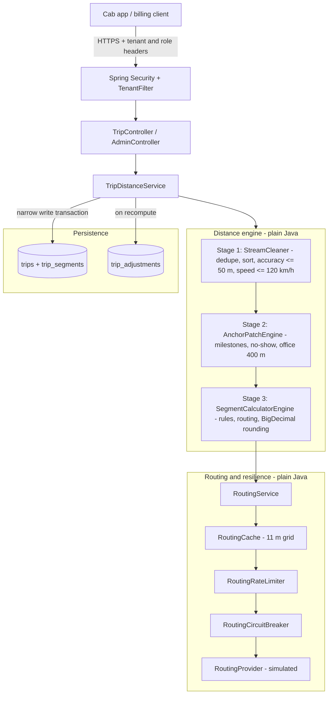
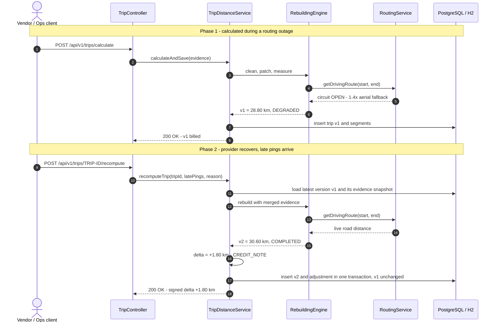
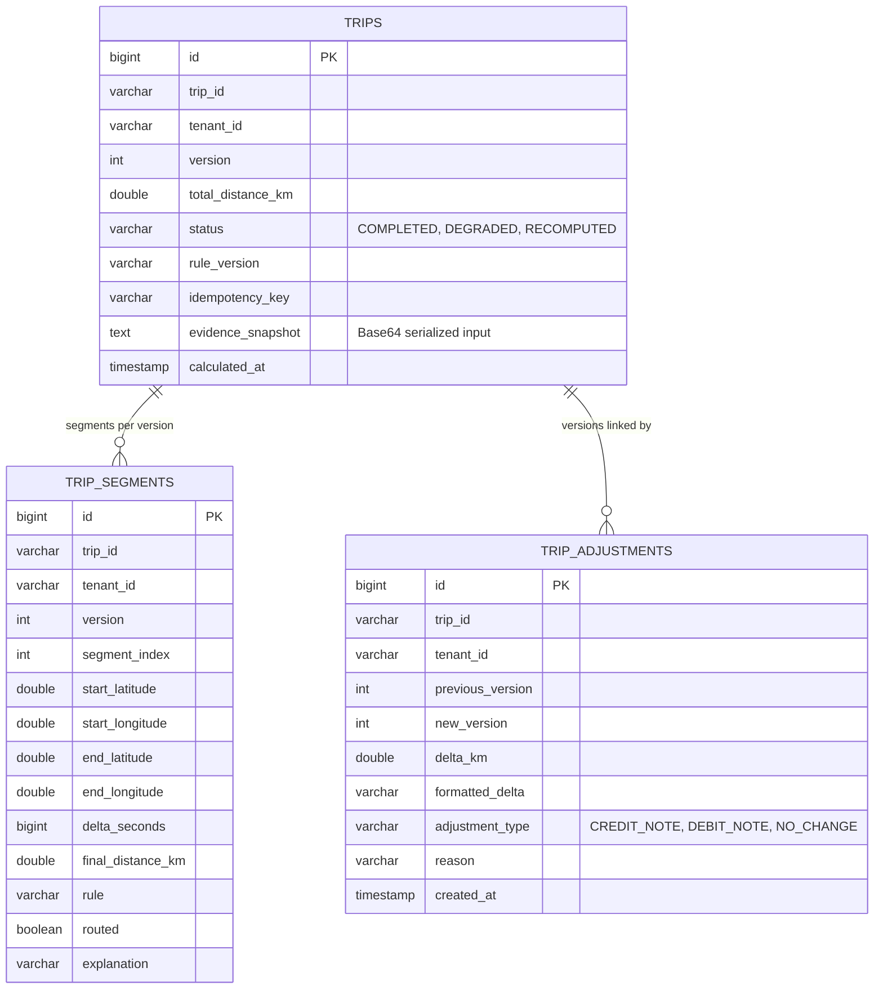

# Design Note — Trip Distance Rebuilding Engine

> Data model, main components, APIs and failure modes were decided **before implementation**. This note records those decisions and why they were made. For run instructions and API examples, see [README.md](README.md).

---

## 1. Decisions Made Before Coding

| Dimension | Decision | Implemented by |
| :--- | :--- | :--- |
| **Data model** | Immutable domain value objects; append-only trip versions; separate signed-adjustment ledger | `Coordinate`, `GpsPing`, `AnchorPoint`, `SegmentResult`, `TripEvidence` · `TripEntity`, `TripSegmentEntity`, `TripAdjustmentEntity` |
| **Main components** | Plain-Java 3-stage engine (no Spring/JPA) + a routing layer behind an interface | `StreamCleaner`, `AnchorPatchEngine`, `SegmentCalculatorEngine` · `RoutingService`, `RoutingCache`, `RoutingRateLimiter`, `RoutingCircuitBreaker` |
| **APIs** | Tenant-scoped REST with role-based access and optional idempotency key | `POST /calculate`, `POST /batch-calculate`, `POST /{tripId}/recompute`, `GET /{tripId}`, `GET /{tripId}/adjustments`, `POST /admin/reconcile-degraded` |
| **Failure modes** | Degrade visibly instead of failing; correct later via signed adjustments | Accuracy and teleport filters, milestone anchoring, `1.4×` fallback with `DEGRADED` status, versioned recompute |

---

## 2. Architecture

**Key boundaries**

- The engine depends only on the `RoutingProvider` interface; swapping the simulator for OSRM or Google Maps needs no rule changes.
- Computation and routing happen **before** the DB transaction opens, so a connection is held only for the final insert.
- Versioning and signed deltas (`RecomputeDelta`) live in `TripDistanceService`, outside the pure engine.

---

## 3. Processing Pipeline

1. **Stream cleaning (`StreamCleaner`)** — drop malformed fixes; for duplicate timestamps keep the smallest accuracy radius; sort by time; drop accuracy > 50 m; drop a ping whose implied speed from the **last accepted** ping exceeds 120 km/h.
2. **Gap patching (`AnchorPatchEngine`)** — insert pickup / drop / no-show anchors. If a milestone has no usable coordinate, fall back by rider type: `PLANNED` → planned stop → home location; `AD_HOC` → home location → planned stop. The actual trip-end point is used only if within 400 m of the office; otherwise the office coordinate is anchored.
3. **Segment measurement (`SegmentCalculatorEngine`)** — evaluated in this order:

   | Order | Condition | Rule | Distance |
   | :-: | :--- | :--- | :--- |
   | 1 | Gap < 70 s **and** implied speed ≤ 120 km/h | `SHORT_GAP_AERIAL` | Haversine |
   | 2 | Gap ≥ 70 s **and** implied speed < 5 km/h | `PARKED` | Haversine |
   | 3 | Otherwise → routing: rate limiter has no permit | `DEGRADED_RATE_LIMITED` | 1.4 × Haversine |
   | 4 | Circuit breaker open | `DEGRADED_CIRCUIT_OPEN` | 1.4 × Haversine |
   | 5 | Provider error | `DEGRADED_PROVIDER_ERROR` | 1.4 × Haversine |
   | 6 | Routed distance > 100 km | `REJECTED_MAX_DISTANCE` | Haversine |
   | 7 | Routed speed > 120 km/h **and** 1.4 × aerial speed > 120 km/h | `REJECTED_SPEED` | Haversine |
   | 8 | Valid route (cache hit or live call) | `ROUTED` | Road distance |

   Any `DEGRADED_*` segment marks the whole trip `DEGRADED`. A short gap with implied speed above 120 km/h is **not** treated as a short gap; it is sent to routing so the distance can be validated.

4. **Rounding** — each segment is rounded to 3 decimals and summed with `BigDecimal`; the trip total is rounded to 2 decimals (`0.01 km`), `HALF_UP`. Same evidence + same rule version (`v1.2.0`) ⇒ same result.

---

## 4. Outage and Late-Ping Recompute

Delta = round₂(new) − round₂(previous): positive → `CREDIT_NOTE`, negative → `DEBIT_NOTE`, zero → `NO_CHANGE`.

---

## 5. Data Model

- **Unique** `(trip_id, tenant_id, version)` — one row per version; a concurrent duplicate recompute fails instead of overwriting.
- `(status, tenant_id)` index — finds `DEGRADED` trips for reconciliation.
- `(trip_id, tenant_id, idempotency_key)` index — replays of the same request return the stored result.
- The evidence snapshot lets a recompute merge only the **new** late pings with the original input.

---

## 6. Failure Modes

| Failure | Cause | Mitigation | Outcome |
| :--- | :--- | :--- | :--- |
| Teleport jump | Multipath fix implying > 8,000 km/h | Speed checked against last accepted ping; ping dropped | No phantom distance |
| Low-accuracy fix | Accuracy radius > 50 m | Dropped in stage 1 | No zig-zag inflation |
| Long GPS blackout | Underpass / basement during pickups | Milestone anchors + routed gap | Road distance paid (~30.6 km vs ~18.4 km naive) |
| Employee no-show | Rider absent at pickup | `includeNoShowAnchors` anchors the stop | Vendor paid for the detour |
| Trip ended far from office | Driver ends trip > 400 m away | End point snapped to office | No billing for post-trip driving |
| Provider outage / throttling | `503`, timeouts, quota | Breaker (10-call window, 50 %, 3 s reset, 3 trial calls) or rate limiter → `1.4×` fallback, trip `DEGRADED` | Billing continues; healed via `/admin/reconcile-degraded` |
| Implausible provider route | > 100 km or impossible speed | Provider result discarded, Haversine used | Bad route never billed |
| Late pings after billing | Phone syncs hours later | New version + signed adjustment | Original invoice untouched |
| Duplicate submission | Client retry | `X-Idempotency-Key` replay | No double billing |
| Cross-tenant access | Buggy / malicious client | Every query scoped by `TenantContext` | Treated as not found (`400`); no data leak |

---

## 7. Performance

`ScaleBenchmarkTest` — engine only (no HTTP, DB or network), simulated provider with an injected outage for trips 4,000–4,500, AMD Ryzen 5 5500H, Windows 11, OpenJDK 21:

| Metric | Result |
| :--- | :--- |
| Workload | 10,000 trips × 1,500 pings = 15M pings |
| Throughput | 508.8 trips/s · 763,242 pings/s |
| Latency per trip | p50 1.78 ms · p95 2.84 ms · p99 4.42 ms |
| Route cache hit rate | 90.0 % (13,497 / 15,000) |
| Heap growth | 2.27 MB |

Complexity: `O(N log N)` per trip (sorting), `O(N)` memory; route cache bounded at 50,000 entries.

---

## 8. Scaling and Hardening

1. **Narrow transactions** — computation and routing run outside the transaction; the DB connection is held only for the write.
2. **Evidence snapshots** — recompute needs only the late pings; the original input is restored from the snapshot.
3. **Idempotency** — optional `X-Idempotency-Key` prevents duplicate billing on retries.
4. **Outbound protection** — grid cache + token bucket + circuit breaker keep provider cost and quota under control.
5. **Horizontal scale** — the engine is stateless apart from a per-instance cache, so nodes can sit behind a load balancer.
6. **Enterprise Architecture (Fully Implemented)**:
   - **Shared Redis L2 Cache**: `SpringDataRedisRouteStorage` coordinates multi-instance route cache hits backing the Caffeine L1 cache with zero failure risk.
   - **Kafka Stream Ingestion**: `trip-gps-pings` topic keyed by `tripId` guaranteeing that all pings for the same trip arrive at the exact same partition for strict FIFO ordering (`TripKafkaBufferService`).
   - **Transactional Outbox Pattern**: `outbox_events` table populated atomically alongside adjustments + scheduled `OutboxRelayService` publishing to `trip-adjustments`.
   - **Versioned Flyway Migrations**: `V1__init_schema.sql` and `V2__create_outbox_table.sql` managing database schema evolution.
   - **JWT Authentication**: Native Java 21 `JwtTokenProvider` (RFC 7519 HMAC-SHA256), `POST /api/v1/auth/token`, and `Authorization: Bearer <token>` support with backward-compatible header fallback.
   - **Real OSRM Routing Adapter**: `OsrmRoutingProvider` invoking Open Source Routing Machine with connect/read timeouts and circuit breaker fallback.
