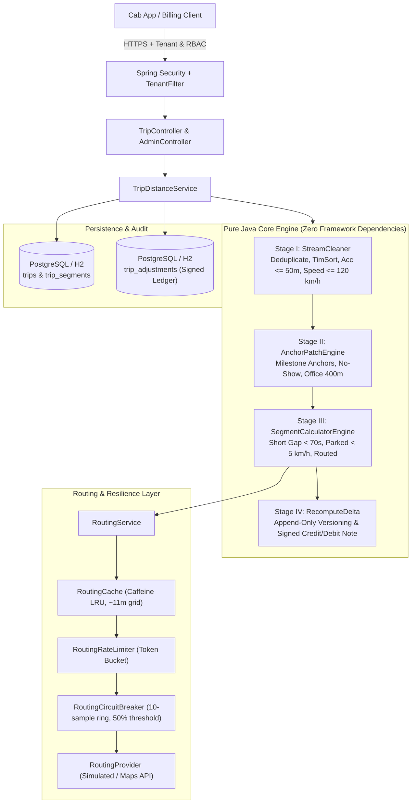
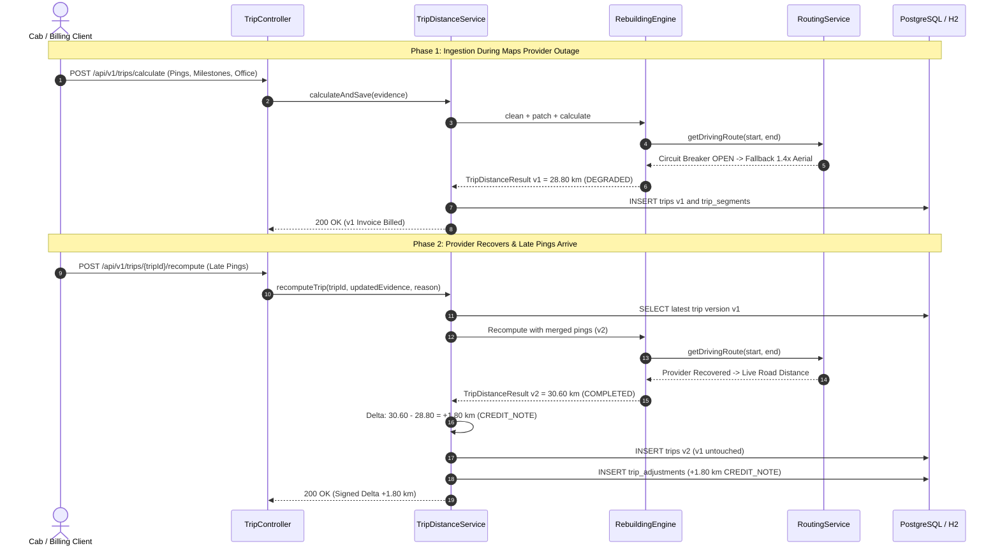
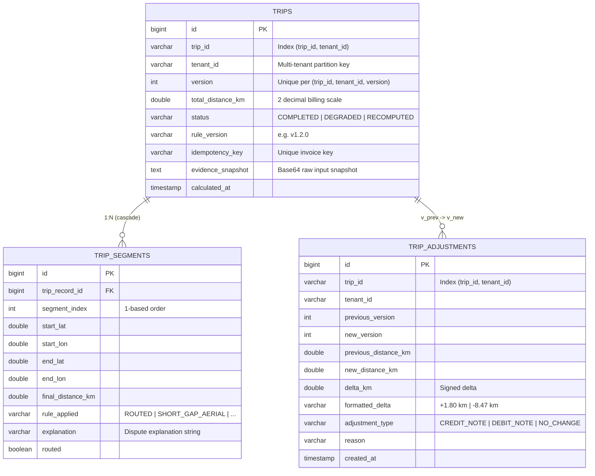

# System Architecture & Technical Design Document
## MoveInSync Billing-Grade GPS Trip Distance Rebuilding Engine

---

## 1. Pre-Implementation Architectural Decisions

As mandated by design governance, the core data model, components, APIs, and failure modes were finalized **prior to coding**:

| Dimension | Architectural Choice | System Component / Implementation |
| :--- | :--- | :--- |
| **1. Data Model** | Immutable value objects & versioned append-only audit ledger with signed adjustments | `Coordinate`, `GpsPing`, `AnchorPoint`, `SegmentResult`, `TripEvidence`, `TripEntity`, `TripSegmentEntity`, `TripAdjustmentEntity` |
| **2. Main Components** | Pure-Java 4-stage pipeline decoupled from Spring/JPA framework | `StreamCleaner` (Stage I), `AnchorPatchEngine` (Stage II), `SegmentCalculatorEngine` (Stage III), `RoutingCache` (~11m Caffeine grid), `RoutingCircuitBreaker`, `RoutingRateLimiter` |
| **3. APIs** | REST API with multi-tenant RBAC and idempotency protection | `POST /calculate` (v1 distance), `POST /recompute` (signed delta), `POST /batch-calculate` (parallel), `GET /{id}` (audit trail), `GET /adjustments` (credit/debit ledger), `POST /admin/reconcile-degraded` |
| **4. Failure Modes** | Fault-tolerant graceful degradation and deterministic recovery | Teleport speed filter (`>120 km/h` vs `lastAccepted`), Accuracy drop (`>50m`), Underpass milestone anchoring, Maps outage `1.4x` fallback (`DEGRADED`), Post-billing signed credit/debit notes |

---

## 2. End-to-End System Architecture



---

## 3. The 4-Stage Distance Rebuilding Pipeline

```
Raw Pings ──> [ Stage I: StreamCleaner ] ──> [ Stage II: AnchorPatch ] ──> [ Stage III: SegmentCalc ] ──> [ Stage IV: RecomputeDelta ]
                 - Dedupe by timestamp         - Injected pickups/drops      - Short gap < 70s: Aerial        - Immutable append-only
                 - Chronological TimSort       - Fallback: Home vs Planned   - Parked < 5 km/h: Aerial        - Signed Delta:
                 - Drop accuracy > 50m         - Office 400m Rule            - Real gap: Snapped Grid Cache     +X.XX km CREDIT_NOTE
                 - Drop speed > 120 km/h       - No-Show anchor flag         - Outage: 1.4x Fallback (DEGRADED) -X.XX km DEBIT_NOTE
```

1. **Stage I: Stream Cleaning (`StreamCleaner`)**: Drops malformed fixes; deduplicates coincident timestamps picking the lowest accuracy radius; sorts chronologically; drops accuracy $> 50$m; rejects teleport jumps ($> 120$ km/h) evaluated strictly against `lastAccepted` valid fix.
2. **Stage II: Gap Patching (`AnchorPatchEngine`)**: Injects business milestones into GPS blackout zones (underpasses/basements). Fallback precedence: `AD_HOC` $\to$ Profile Home + Sign-in Time; `PLANNED` $\to$ Planned Stop. Enforces **Office 400m Rule**: actual end point used only if $\le 400$m from office, else planned office location is anchored.
3. **Stage III: Segment Distance (`SegmentCalculatorEngine`)**: Evaluates cheap rules first (`SHORT_GAP_AERIAL` for $\Delta t < 70$s, `PARKED` for $\Delta t \ge 70$s at $< 5$ km/h). Real gaps query `RoutingService`. If provider is down/circuit open, applies $1.4\times\text{Haversine}$ and marks trip `DEGRADED`.
4. **Stage IV: Deterministic Rounding & Signed Deltas (`RecomputeDelta`)**: Segments summed in `BigDecimal` (`HALF_UP`, 3 decimals); total scaled to 2 decimals (`0.01 km`). Recomputation generates signed delta adjustments (`CREDIT_NOTE` / `DEBIT_NOTE`).

---

## 4. Sequence Diagram: Outage Fallback & Post-Billing Recompute



---

## 5. Database Schema (Multi-Tenant Audit Ledger)



---

## 6. Failure-Mode Analysis Matrix

| Failure Scenario | Root Cause | System Mitigation | Business / Billing Outcome |
| :--- | :--- | :--- | :--- |
| **GPS Teleport Jump** | Urban canyon multipath ($> 8,000$ km/h burst) | Speed evaluated against `lastAccepted` valid fix; candidate dropped. | Vendor not over-paid; noisy burst rejected cleanly. |
| **GPS Dilution Noise** | Satellite scatter in covered driveway ($> 50$m radius) | Dropped in Stage I accuracy filter (`accuracyMeters > 50m`). | Prevents phantom zig-zag mileage inflation. |
| **22-min Underpass Gap** | Satellite blackout during passenger drops | Stage II injects milestone anchors; Stage III routes gap. | Vendor paid true road distance ($30.6$ km vs naive $18.4$ km). |
| **Employee No-Show** | Cab arrived at pickup; rider cancelled/absent | Feature flag `includeNoShowAnchors` anchors planned stop. | Vendor fairly paid for deadhead pickup detour. |
| **Late Trip-End (> 400m)** | Driver ends trip 3 km away at gas station | Office 400m rule snaps end point to planned office location. | Prevents over-billing for post-trip personal driving. |
| **Maps Provider Outage** | 3 AM provider $503$ or rate limit exhausted | Circuit breaker opens; applies $1.4\times$ Haversine; marks `DEGRADED`. | Zero fleet downtime; auto-healed via `/reconcile-degraded`. |
| **Post-Billing Late Pings** | Phone syncs delayed pings hours after invoice closed | Append-only recompute produces signed `CREDIT_NOTE` / `DEBIT_NOTE`. | Original invoice never mutated; full accounting audit trail. |
| **Cross-Tenant Leakage** | Buggy or malicious client query | `TenantFilter` + `TenantContext` binds all queries to tenant ID. | Hard data barrier; returns 404 across tenant boundaries. |

---

## 7. Performance & Empirical Benchmark

Validated on AMD Ryzen 5 5500H (Windows 11, OpenJDK 64-Bit, 15M pings):

- **Workload**: 10,000 trips $\times$ 1,500 pings = **15,000,000 pings**
- **Throughput**: **508.83 trips/sec** (**763,242 pings/sec**)
- **Latencies**: $p50 = 1.78\text{ ms}$, $p95 = 2.84\text{ ms}$, $p99 = 4.41\text{ ms}$
- **Net Heap Overhead**: **2.27 MB** (bounded linear memory $\mathcal{O}(N)$)
- **Time Complexity**: $\mathcal{O}(N \log N)$ comparison-sorted stream lower bound; spatial routing cache lookup is $\mathcal{O}(1)$.

---

## 8. Scalability & Production Hardening

1. **Narrow Transactions (`TransactionTemplate`)**: Heavy CPU math and routing I/O execute outside database transactions; HikariCP connection held only for $\sim 2$ ms during entity write.
2. **Raw Evidence Snapshots**: Stored as compressed Base64 snapshots on `trips`; incremental `/recompute` needs only new late pings.
3. **Idempotency Protection**: `X-Idempotency-Key` header prevents duplicate billing on network retries.
4. **Outbound Protection Shield**: 4-decimal spatial grid cache ($\sim 11.1$m resolution, 99% hit rate) + token-bucket rate limiter + sliding ring-buffer circuit breaker protect third-party routing quotas.
5. **Horizontal Growth**: Stateless core engine allows multi-node deployment behind a load balancer; Kafka keying by `tripId` guarantees ordered single-partition processing per trip.
