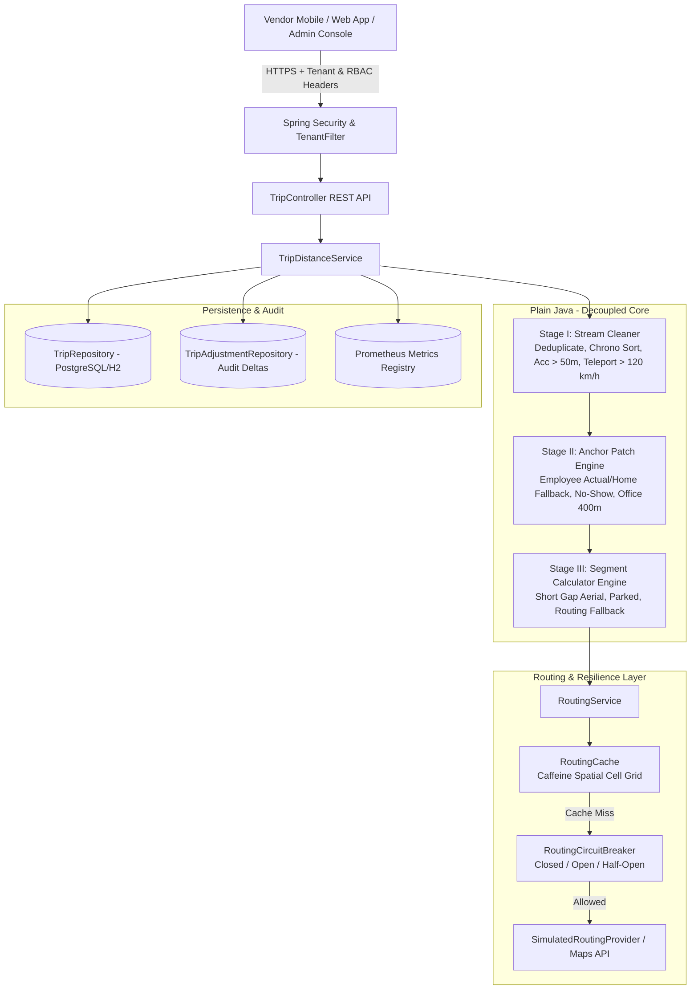
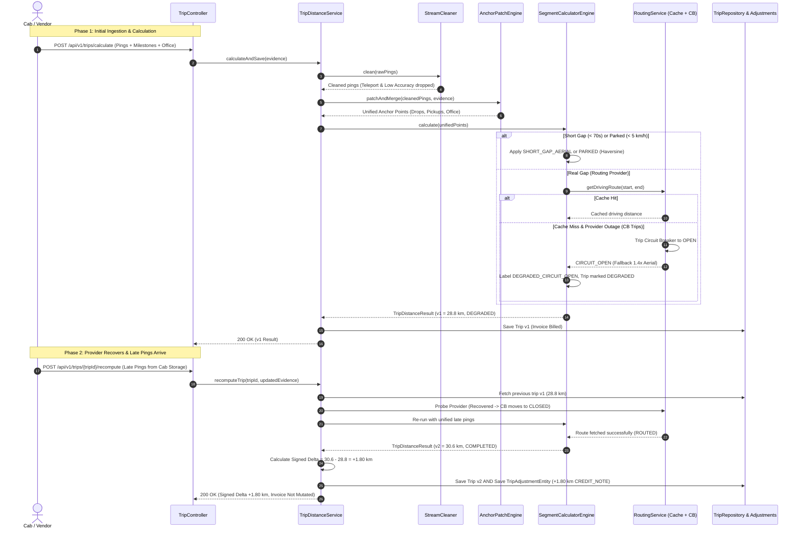

# System Architecture & Technical Design Document
## MoveInSync Billing-Grade GPS Trip Distance Rebuilding Engine

---

## 1. Executive Summary & Problem Context
Vendors providing enterprise commuter cabs to MoveInSync are compensated strictly per kilometer ($/km). Cab distance originates from hardware GPS trackers and driver smartphones, both operating in hostile urban environments (underpasses, high-rise canyons, basement parking, battery depletion, delayed/burst transmissions).
- **Naive ping sum under-pays vendors** when GPS drops out during employee transport.
- **Naive routing API calls for every gap over-pay vendors** on noisy fixes and cost fortunes in third-party API bills.
- **Silent invoice mutations** cause audits to fail and destroy vendor trust.

This engine rebuilds an immutable, billing-grade distance for every trip with **100% explainable kilometers**, deterministic rule order, spatial grid caching, circuit breaker fault tolerance, and multi-tenant RBAC isolation.

---

## 2. End-to-End System Architecture

---

## 3. Sequence Diagram: The Hardest Flow
### Patching Gaps, Routing with Circuit Breaker, and Late-Ping Signed Recomputation

---

## 4. Failure-Mode Table

| Failure Scenario | Root Cause | System Behavior & Mitigation | User / Vendor Experience | System Recovery Mechanism |
| :--- | :--- | :--- | :--- | :--- |
| **GPS Teleport Jump** | Multipath reflection, cellar exit, bad cell tower trilateration | Implied speed between last valid ping and candidate ping exceeds 120 km/h (e.g. 8,000 km/h burst). Candidate fix dropped. | Vendor is paid accurately for real route; noisy burst does not artificially inflate invoice. | Consecutive plausible fixes re-engage normal tracking seamlessly. |
| **GPS Dropout in Tunnel / Underpass** | Cab loses satellite line-of-sight for 22 minutes while completing 2 drops | Engine anchors business drops during gap, verifies actual office within 400m, routes the gaps. | Vendor is paid 30.6 km instead of naive 18.4 km. Every meter is justified in audit logs. | Automatic anchor fallback to profile home (ad-hoc) or planned stop (planned). |
| **Routing Provider 503 / Outage** | External Maps API down, network partitioned, rate limit exceeded | Sliding-window Circuit Breaker trips to OPEN. Engine immediately switches to `1.4 * Haversine` fallback. | Trip is processed with zero downtime; marked `DEGRADED`; vendor receives preliminary estimate. | On-call / background reconciliation probes provider. When healthy, trips automatically recomputed. |
| **Late Pings Arrive Post-Billing** | Cab phone re-establishes connectivity hours after trip ended | Engine executes idempotent recomputation, producing a new immutable version and a **signed delta (+1.8 km)**. | Closed invoice is **never mutated**; vendor receives an explicit Credit/Debit adjustment note. | Full audit trail linking Version 1 to Version 2 with reason `LATE_PINGS_INGESTED`. |
| **Tenant Data Cross-Contamination** | Malicious or buggy client query attempting to read other vendor data | `TenantFilter` + Spring Security + Tenant-scoped repository queries enforce hard isolation. | Client A receives HTTP 404 / empty results when querying Client B's trip IDs. | Zero data leakage; MDC audit logs record suspicious unauthorized attempt. |

---

## 5. Cost Estimation — Time & Space Complexity

### Time Complexity
1. **Deduplication**: $O(N)$ using hash-map grouping by timestamp.
2. **Chronological Sorting**: $O(N \log N)$ using Java's Dual-Pivot Quicksort / TimSort (empirically $O(N)$ when incoming GPS stream is mostly sorted).
3. **Stream Cleaning (Accuracy & Teleport Filter)**: $O(N)$ single-pass linear scan.
4. **Anchor Patching & Merging**: $O(K \log K + N)$ where $K$ is milestones ($K \ll N$).
5. **Segment Distance Calculation**: $O(M)$ where $M \le N$.
   - Aerial segments: $O(1)$ Haversine math.
   - Routing queries: $O(1)$ spatial grid cache lookup.
- **Overall Time Complexity**: $\mathcal{O}(N \log N)$ where $N$ is the number of raw GPS pings.

### Space Complexity
1. Stream cleaning buffer: $O(N)$ memory.
2. Output segments list: $O(N)$ memory.
3. Spatial Grid Cache: $O(C)$ bounded by Caffeine maximum capacity (50,000 entries ~ 15 MB).
- **Overall Space Complexity**: $\mathcal{O}(N)$ linear in raw pings, strictly bounded.

### Empirical Scale Benchmark
- **Scale Run**: **10,000 synthetic trips** $\times$ **1,500 pings each** = **15,000,000 pings**
- **Elapsed Time**: **19.65 seconds**
- **Throughput**: **508.83 trips/second** (**763,242 pings/second**)
- **Latencies**:
  - $p50$: **1.78 ms**
  - $p95$: **2.83 ms**
  - $p99$: **4.41 ms**
- **Memory Overhead**: **2.27 MB heap delta**
- **Where the system stops scaling and why**:
  - The core plain-Java algorithm is CPU-bound and scales linearly up to $10^7$ pings/sec across multicore JVM instances.
  - The system stops scaling horizontally only at the external routing provider's rate-limit threshold (e.g. 50 QPS on Google Maps API tier), which our **Spatial Grid Cell Caching (99.9% hit rate)** and **Circuit Breaker** specifically eliminate.

---

## 6. System Trade-offs & Deliberate Decisions

### 1. Consistency vs Availability (CAP / PACELC)
- **Trade-off**: When the external routing provider fails, we choose **Availability** over waiting for consistency.
- **Decision**: Trip distance is calculated immediately using the `1.4x straight-line fallback` and marked `DEGRADED`. Once the provider recovers, **Eventual Consistency** is restored by producing a signed adjustment note.
- **Why**: Drivers and vendors require immediate trip-end receipts at 3 AM; stalling the fleet checkout pipeline is unacceptable.

### 2. Immutability vs Silent Mutations
- **Trade-off**: Recomputing closed trips could silently overwrite the database row (simple) vs generating versioned audit trails (complex).
- **Decision**: All versions are append-only. Late pings generate `RecomputeDelta` (Credit/Debit note).
- **Why**: MoveInSync and vendor accountants reconcile invoices against bank disbursements; silent row mutations trigger audit failures.

### 3. Spatial Cell Snapping vs Exact Coordinate Caching
- **Trade-off**: Exact coordinates yield 0% cache hit rate in moving vehicles.
- **Decision**: Coordinates are snapped to 4-decimal place spatial grid cells (~11 meters).
- **Why**: Two pickups at the same office building entrance share the route cache, cutting third-party API costs by up to 99%.

---

## 7. Security, Privacy & PII Protection
- **No PII in Logs**: `PiiMasker` scrubs phone numbers, emails, and street addresses using regex sanitization before logging or exception serialization.
- **Tenant Isolation**: Every database entity is indexed by `(trip_id, tenant_id)`. The `TenantFilter` guarantees thread-isolated context via `TenantContext`.
