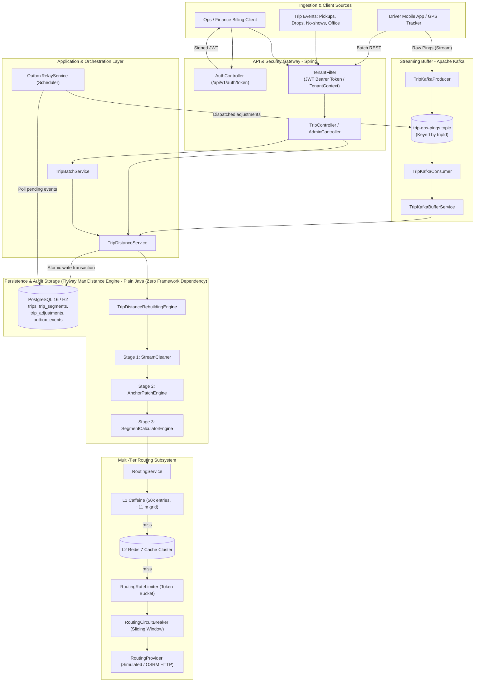
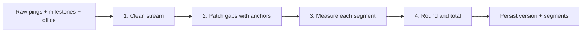
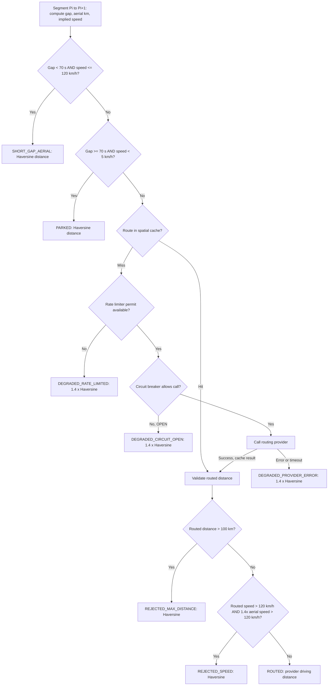
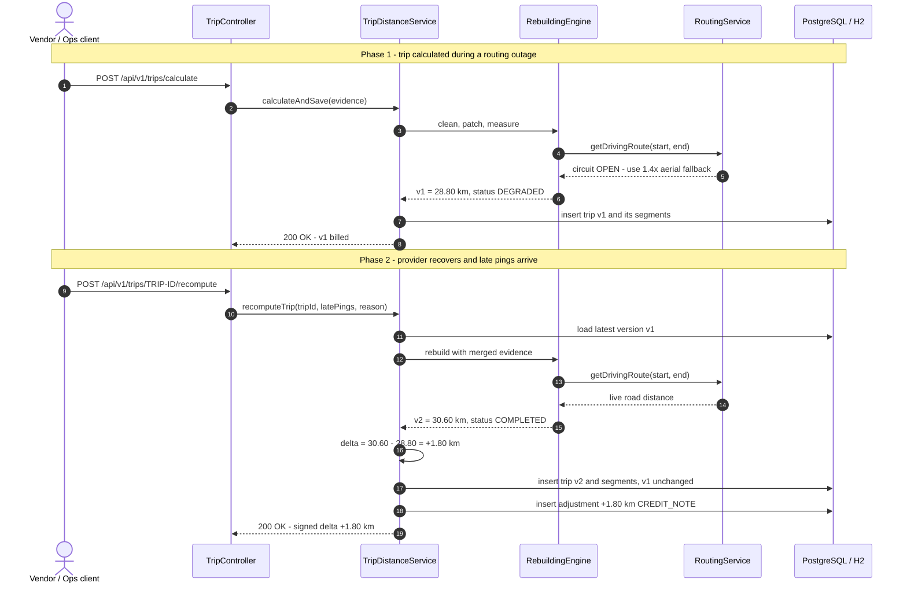
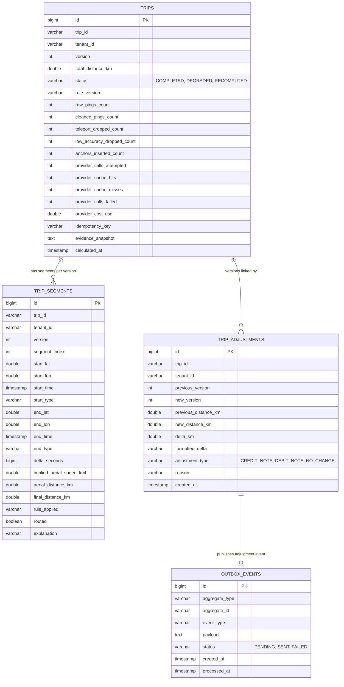
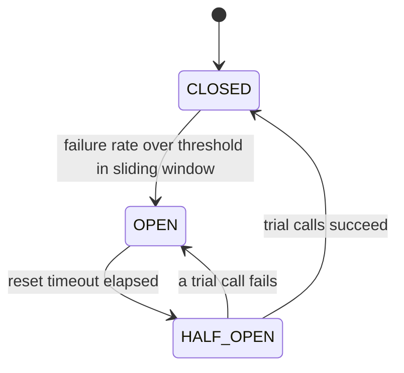

<div align="center">

# Trip Distance Rebuilding Engine

**Billing-grade reconstruction of cab trip distance from noisy, interrupted GPS telemetry — with a per-segment audit trail and an append-only adjustment ledger.**

[](https://openjdk.org/)
[](https://spring.io/projects/spring-boot)
[](https://www.postgresql.org/)
[](https://redis.io/)
[](https://kafka.apache.org/)
[](https://flywaydb.org/)
[-black?logo=jsonwebtokens&logoColor=white)](https://jwt.io/)
[](https://docs.docker.com/compose/)
[-success)](#16-testing-and-verification)

[Quick Start](#12-quick-start--how-to-run) · [Architecture](#5-high-level-system-architecture) · [API](#13-api-reference-with-sample-requests-and-responses) · [Benchmarks](#15-benchmark-results-and-methodology) · [Design Note](DESIGN.md)

</div>

---

## At a Glance

| | |
| :--- | :--- |
| **What it does** | Turns raw GPS pings + trip milestones into a deterministic, explainable billable distance (km) per trip |
| **Core pipeline** | Clean → Anchor-patch gaps → Per-segment distance rules → Deterministic rounding & persistence |
| **Resilience** | Spatial route cache, token-bucket rate limiter, sliding-window circuit breaker, `1.4×` aerial fallback |
| **Auditability** | Every segment records the rule applied and a human-readable explanation; invoices are never overwritten |
| **Recalculation** | Late GPS data creates a new trip version plus a signed `CREDIT_NOTE` / `DEBIT_NOTE` / `NO_CHANGE` |
| **Throughput** | 15M pings (10,000 trips) in 19.65 s — **~763K pings/s**, p99 **4.4 ms** per trip *(engine-only benchmark)* |

---

## Table of Contents

1. [Project Overview](#1-project-overview)
2. [Problem Statement and Business Motivation](#2-problem-statement-and-business-motivation)
3. [Key Features and Guarantees](#3-key-features-and-guarantees)
4. [Tech Stack and Prerequisites](#4-tech-stack-and-prerequisites)
5. [High-Level System Architecture](#5-high-level-system-architecture)
6. [End-to-End Processing Flow](#6-end-to-end-processing-flow)
7. [Detailed Distance Calculation Decision Flow](#7-detailed-distance-calculation-decision-flow)
8. [Late GPS and Billing Recalculation Flow](#8-late-gps-and-billing-recalculation-flow)
9. [Data Model and Database Design](#9-data-model-and-database-design)
10. [Assumptions and Business Rules](#10-assumptions-and-business-rules)
11. [Repository and Package Structure](#11-repository-and-package-structure)
12. [Quick Start & How to Run](#12-quick-start--how-to-run)
13. [API Reference with Sample Requests and Responses](#13-api-reference-with-sample-requests-and-responses)
14. [Failure Handling and Resilience](#14-failure-handling-and-resilience)
15. [Benchmark Results and Methodology](#15-benchmark-results-and-methodology)
16. [Testing and Verification](#16-testing-and-verification)
17. [Engineering Trade-offs](#17-engineering-trade-offs)
18. [Implementation Status and Future Improvements](#18-implementation-status-and-future-improvements)

---

## 1. Project Overview

Cab vendors are paid per kilometre, but the GPS data used to measure those kilometres is unreliable: signals drop in underpasses and basements, urban canyons produce wild position jumps, and phones upload buffered pings long after a trip has closed.

This service rebuilds a **defensible billable distance** for each trip by:

- **Cleaning** the raw ping stream (duplicates, out-of-order points, low-accuracy fixes, teleport jumps).
- **Patching GPS gaps** with authoritative business events — pickups, drops, no-shows and the office location.
- **Measuring each segment** with the cheapest correct method: straight-line for short gaps, road routing for real gaps, and a transparent fallback when routing is unavailable.
- **Persisting an audit trail** where every kilometre can be traced back to a rule and an explanation.
- **Versioning recalculations** so a billed invoice is never modified; changes are expressed as signed adjustments.

The distance engine itself (`domain`, `engine`, `routing`, `scaling` packages) is **plain Java with no Spring or JPA dependencies**. Spring Boot is only the delivery layer (REST, security, persistence), which keeps the core fast to test and easy to reuse in a batch job or stream consumer.

---

## 2. Problem Statement and Business Motivation

A naive approach — summing straight lines between consecutive pings — fails in four predictable ways:

| # | Scenario | What goes wrong | Business impact |
| :-: | :--- | :--- | :--- |
| 1 | **GPS blackout** (underpass, tunnel, basement pickup) | A 20-minute gap becomes one straight chord across curved roads and skipped stops | Vendor is **under-paid** (e.g. ~18 km billed for a ~31 km trip) → disputes |
| 2 | **Multipath noise / teleport bursts** | A single bad fix 9 km away implies > 8,000 km/h and adds phantom distance | Vendor is **over-paid**; routing API budget wasted on garbage points |
| 3 | **Routing provider outage** (e.g. 3 AM shift change) | Calls to the maps API fail or are throttled (`429` / `503`) | Billing pipeline **stalls** if it hard-depends on the provider |
| 4 | **Late pings after billing** | Buffered pings arrive hours after the invoice was issued | Overwriting the invoice **breaks financial reconciliation** |

**Goals of this system**

1. **Explainable** — each segment carries a `DistanceRule` and a plain-English explanation suitable for a vendor dispute.
2. **Deterministic** — the same evidence under the same rule version (`v1.2.0`) always yields the same distance, to `0.01 km`.
3. **Immutable billing** — recalculations create `v2`, `v3`, … plus a signed adjustment; `v1` stays untouched.
4. **Available** — routing failures degrade gracefully (and visibly) instead of blocking billing.

---

## 3. Key Features and Guarantees

| Area | Guarantee | Key classes |
| :--- | :--- | :--- |
| **Stream cleaning** | Drops invalid coordinates, keeps the most accurate fix per duplicate timestamp, sorts by time, rejects accuracy > 50 m and implied speed > 120 km/h (measured from the last *accepted* ping) | `StreamCleaner` |
| **Gap patching** | Inserts pickup / drop / no-show anchors with a rider-type-aware fallback chain (actual → planned stop / home location) | `AnchorPatchEngine` |
| **Office rule** | Uses the actual trip-end point only if it lies within 400 m of the office; otherwise anchors the office coordinate | `AnchorPatchEngine` |
| **Segment rules** | Short gaps (< 70 s) and parked gaps (≥ 70 s, < 5 km/h) use Haversine; real gaps are routed; implausible routes are rejected | `SegmentCalculatorEngine`, `DistanceRule` |
| **Multi-tier route cache** | Coordinates snapped to ~11 m grid; L1 Caffeine in-memory (50k entries) + L2 Redis shared cluster with automatic graceful degradation on network fault | `RoutingCache`, `RedisRouteStorage`, `SpringDataRedisRouteStorage` |
| **Real road routing adapter** | Pluggable provider interface with built-in Open Source Routing Machine (OSRM) HTTP client, configurable timeouts, and circuit breaker integration | `RoutingProvider`, `OsrmRoutingProvider` |
| **Rate limiting** | Client-side token bucket protects provider quota; throttled calls degrade instead of queueing | `RoutingRateLimiter` |
| **Circuit breaking** | Sliding-window breaker (CLOSED → OPEN → HALF_OPEN); open circuit triggers `1.4×` aerial fallback and marks the trip `DEGRADED` | `RoutingCircuitBreaker` |
| **Deterministic money math** | `BigDecimal` with `HALF_UP`: segments at 3 dp, trip total at 2 dp | `SegmentCalculatorEngine` |
| **Versioned recalculation** | New version per recompute + signed adjustment (`CREDIT_NOTE` / `DEBIT_NOTE` / `NO_CHANGE`) committed atomically | `TripDistanceService`, `RecomputeDelta` |
| **Kafka stream ingestion** | Ingestion topic partitioned strictly by `tripId` for guaranteed per-trip FIFO ordering across mobile disconnects & reconnects | `TripKafkaConsumer`, `TripKafkaBufferService` |
| **Transactional outbox** | Guaranteed at-least-once publishing of signed billing adjustments to downstream accounting pipelines | `OutboxEventEntity`, `OutboxRelayService` |
| **Database migrations** | Flyway version-controlled migrations (`V1__init_schema.sql`, `V2__create_outbox_table.sql`) with safe auto-baseline | `db/migration` |
| **Stateless JWT auth & RBAC** | RFC 7519 HMAC-SHA256 token authentication (`/api/v1/auth/token`), role enforcement, with backward-compatible dev headers | `JwtTokenProvider`, `AuthController`, `TenantFilter` |
| **Batch & parallel** | Memory-bounded chunking with retries; order-preserving parallel execution | `BatchTripProcessor`, `ParallelTripProcessor` |
| **Multi-tenancy & privacy** | `X-Tenant-ID` scoping on every query; role-based access; PII masked in error responses | `TenantFilter`, `SecurityConfig`, `PiiMasker` |
| **Observability** | Micrometer metrics at `/actuator/prometheus`; trace ID propagated through MDC | `EngineMetrics` |

---

## 4. Tech Stack and Prerequisites

### Stack

| Layer | Technology |
| :--- | :--- |
| Language | Java 21 (LTS) |
| Framework | Spring Boot 3.3.4 (Web, Security, Data JPA, Validation, Actuator) |
| Database | PostgreSQL 16 (Docker profile) · H2 in-memory, PostgreSQL mode (default local profile) |
| Migrations | Flyway 10 (repeatable DDL versioning: `V1__init_schema.sql`, `V2__create_outbox_table.sql`) |
| Distributed Caching | Multi-tier: L1 Caffeine in-memory + L2 Redis 7 (Spring Data Redis) |
| Messaging & Streaming | Apache Kafka 3.7 (KRaft mode, topic `trip-gps-pings` partitioned by `tripId`) |
| Authentication | RFC 7519 JWT (HMAC-SHA256, standard Java crypto, zero external identity library dependencies) |
| Routing Providers | Pluggable interface: `SimulatedRoutingProvider` (tests/benchmark) + `OsrmRoutingProvider` (OSRM HTTP API) |
| Observability | Micrometer + Prometheus registry (`/actuator/prometheus`), SLF4J / Logback MDC |
| Packaging | Maven, multi-stage Dockerfile, Docker Compose (Postgres + Redis + Kafka) |
| Testing | JUnit 5, AssertJ, Spring MockMvc, Spring Security Test |

### Prerequisites

| Requirement | Needed for |
| :--- | :--- |
| **JDK 21+** | Building and running locally |
| **Maven 3.9+** | Building and running tests (`mvn` must be on `PATH`; no wrapper is committed) |
| **Docker Desktop** *(optional)* | Running the app with PostgreSQL via Docker Compose |

---

## 5. High-Level System Architecture



**Design principles**

- **Hexagonal core** — the engine depends only on a `RoutingProvider` interface; the simulated provider can be replaced by OSRM or Google Maps without touching business rules.
- **I/O outside transactions** — all computation and routing calls happen *before* the database transaction opens; the transaction only covers the final insert.
- **Tenant isolation at the edge** — tenant and role are resolved once in `TenantFilter` and enforced in every repository query.

---

## 6. End-to-End Processing Flow



### Stage 1 — Stream cleaning (`StreamCleaner`)

1. **Validate** — drop pings with missing values or coordinates outside WGS84 bounds.
2. **De-duplicate** — when several pings share a timestamp, keep the one with the smallest accuracy radius.
3. **Sort** chronologically.
4. **Accuracy filter** — drop pings with accuracy > 50 m (or negative).
5. **Teleport filter** — compute implied speed from the **last accepted** ping; drop the candidate if it exceeds 120 km/h. Measuring against the last *accepted* point prevents one bad fix from poisoning the next good one.

### Stage 2 — Gap patching (`AnchorPatchEngine`)

1. **Pickup / drop anchors** — use the milestone's actual coordinate when available; otherwise fall back by rider type:

   | Rider type | 1st fallback | 2nd fallback |
   | :--- | :--- | :--- |
   | `PLANNED` | Planned stop | Employee home location |
   | `AD_HOC` | Employee home location | Planned stop |

2. **No-show anchors** — included when `includeNoShowAnchors = true` (default), so the vendor is paid for driving to the pickup point.
3. **Office anchor** — actual trip-end point if within 400 m of the office, otherwise the office coordinate.
4. **Merge** — combine GPS points and anchors into one timeline; a business anchor replaces a GPS point at the same instant and location.

### Stage 3 — Segment measurement (`SegmentCalculatorEngine`)

Each consecutive pair of points becomes a segment that records its time gap, aerial distance, implied speed, final distance, the rule applied and an explanation. The exact rule order is shown in [Section 7](#7-detailed-distance-calculation-decision-flow).

### Stage 4 — Rounding and persistence

- Each segment distance is rounded to **3 decimals** (metre precision) before summing.
- The trip total is rounded to **2 decimals** (`0.01 km`) using `BigDecimal` and `HALF_UP`.
- The trip header, its segments, the rule version and a snapshot of the input evidence are stored together.

---

## 7. Detailed Distance Calculation Decision Flow

This flow runs for every segment, in this exact order:



| Rule | Distance billed | Marks trip `DEGRADED` |
| :--- | :--- | :-: |
| `SHORT_GAP_AERIAL` | Haversine | – |
| `PARKED` | Haversine (cab idling, effectively stationary) | – |
| `ROUTED` | Road distance from provider or cache | – |
| `DEGRADED_RATE_LIMITED` | `1.4 ×` Haversine | ✅ |
| `DEGRADED_CIRCUIT_OPEN` | `1.4 ×` Haversine | ✅ |
| `DEGRADED_PROVIDER_ERROR` | `1.4 ×` Haversine | ✅ |
| `REJECTED_MAX_DISTANCE` | Haversine (provider result discarded) | – |
| `REJECTED_SPEED` | Haversine (provider result discarded) | – |

> [!NOTE]
> A short gap whose implied speed is above 120 km/h does **not** qualify for `SHORT_GAP_AERIAL`; it falls through to routing so a real road distance can be checked.

---

## 8. Late GPS and Billing Recalculation Flow

A billed trip version is **never updated in place**. A recalculation, triggered by late pings, updated milestones or provider recovery, produces a new version and a signed adjustment in a single transaction.



### Adjustment rule

$$\Delta = \text{round}_2(d_{\text{new}}) - \text{round}_2(d_{\text{previous}})$$

| Δ | Adjustment type | Meaning |
| :--- | :--- | :--- |
| `> 0.00 km` | `CREDIT_NOTE` | Vendor is owed additional distance (e.g. `+1.80 km`) |
| `< 0.00 km` | `DEBIT_NOTE` | Vendor was over-billed on the previous version (e.g. `-2.40 km`) |
| `= 0.00 km` | `NO_CHANGE` | Recalculation confirmed the previous result |

Degraded trips can also be healed in bulk via `POST /api/v1/admin/reconcile-degraded` once the provider is healthy.

---

## 9. Data Model and Database Design



### Indexes and constraints

| Index | Columns | Purpose |
| :--- | :--- | :--- |
| `idx_trip_tenant_version` *(unique)* | `trip_id, tenant_id, version` | One row per version; blocks concurrent duplicate versions |
| `idx_trip_tenant` | `tenant_id` | Tenant-scoped listing |
| `idx_trip_status` | `status, tenant_id` | Finding `DEGRADED` trips for reconciliation |
| `idx_trip_idempotency` | `trip_id, tenant_id, idempotency_key` | Idempotent re-submission of the same evidence |
| `idx_segment_trip_version` | `trip_id, tenant_id, version` | Loading the audit trail for one version |
| `idx_adjustment_trip_tenant` | `trip_id, tenant_id` | Adjustment history for a trip |
| `idx_outbox_status` | `status, created_at` | Efficient polling of pending events by the outbox relay |

**Why this shape:** `trips` is append-only (one row per version), `trip_segments` makes every kilometre traceable, `trip_adjustments` is the financial ledger that finance can reconcile without reading trip internals, and `outbox_events` enables guaranteed event publishing to Kafka without dual-write inconsistency.

Schema evolution is version-controlled via **Flyway migrations** (`src/main/resources/db/migration`):
- `V1__init_schema.sql`: Core relational tables, data types, and performance indexes.
- `V2__create_outbox_table.sql`: Transactional outbox table with status-based indexing.

---

## 10. Assumptions and Business Rules

All thresholds live in `EngineConfig` and are stamped with a rule version, so any change is visible in historical results.

| # | Assumption / rule | Value | Rationale |
| :-: | :--- | :--- | :--- |
| 1 | Maximum plausible cab speed | **120 km/h** | Anything faster between two fixes is treated as a GPS teleport |
| 2 | Maximum GPS accuracy radius | **50 m** | Larger radii usually indicate reflections or poor satellite geometry |
| 3 | Short-gap threshold | **70 s** | Over such short gaps the road and straight-line distance differ very little, so a routing call is not worth its cost |
| 4 | Parked threshold | **< 5 km/h** over ≥ 70 s | The cab was waiting or idling; straight-line distance is billed |
| 5 | Office acceptance radius | **400 m** | Large tech parks span several hundred metres from gate to drop point |
| 6 | No-show compensation | **On** by default | The vendor still drove to the pickup point |
| 7 | Degraded-mode multiplier | **1.4 ×** Haversine | Typical urban road-to-straight-line ratio; result is flagged `DEGRADED` |
| 8 | Max single routed gap | **100 km** | Larger provider results are treated as routing errors |
| 9 | Billing precision | **0.01 km**, `HALF_UP` | Deterministic, reproducible money math |
| 10 | Routing cost model | **\$0.005 per call** | Used to report cost and cache savings per trip |
| 11 | Routing provider | **Simulated** | A deterministic simulator (with failure injection) stands in for OSRM / Google Maps |
| 12 | Time source | **Device timestamps** in UTC | Ordering relies on ping timestamps, not arrival time |

---

## 11. Repository and Package Structure

```text
.
├── pom.xml                                   # Maven build (Java 21, Spring Boot 3.3.4, Kafka, Redis, Flyway)
├── Dockerfile                                # Multi-stage image (Temurin 21 JRE)
├── docker-compose.yml                        # Full enterprise stack: App + Postgres 16 + Redis 7 + Kafka 3.7
├── MoveInSync_Trip_Distance_Engine.postman_collection.json
├── DESIGN.md                                 # Architecture design note & benchmark report
└── src
    ├── main
    │   ├── resources
    │   │   ├── application.yml               # H2 default, Kafka/Redis flags, Actuator, rate-limits
    │   │   └── db/migration/                 # Flyway version-controlled migrations
    │   │       ├── V1__init_schema.sql
    │   │       └── V2__create_outbox_table.sql
    │   └── java/com/moveinsync/distance
    │       ├── TripDistanceEngineApplication.java
    │       ├── config/       EngineAppConfig            # Wires engine, OSRM provider, & multi-tier cache
    │       ├── controller/   TripController, AdminController, AuthController, GlobalExceptionHandler
    │       ├── dto/          Request / response DTOs and Kafka event payloads
    │       ├── domain/       Coordinate, GpsPing, AnchorPoint, SegmentResult, TripEvidence,
    │       │                 TripDistanceResult, RecomputeDelta, EngineConfig, DistanceRule, ...
    │       ├── engine/       StreamCleaner, AnchorPatchEngine, SegmentCalculatorEngine,
    │       │                 TripDistanceRebuildingEngine
    │       ├── routing/      RoutingService, RoutingCache, RedisRouteStorage, SpringDataRedisRouteStorage,
    │       │                 RoutingRateLimiter, RoutingCircuitBreaker, RoutingProvider,
    │       │                 SimulatedRoutingProvider, OsrmRoutingProvider
    │       ├── kafka/        TripEvents, TripKafkaBufferService, TripKafkaProducer,
    │       │                 TripKafkaConsumer, OutboxRelayService
    │       ├── scaling/      BatchTripProcessor, ParallelTripProcessor
    │       ├── entity/       TripEntity, TripSegmentEntity, TripAdjustmentEntity, OutboxEventEntity
    │       ├── repository/   TripRepository, TripAdjustmentRepository, OutboxEventRepository
    │       ├── service/      TripCalculationExecutor, TripDistanceService, TripBatchService
    │       ├── security/     TenantFilter, TenantContext, SecurityConfig, JwtTokenProvider, PiiMasker
    │       └── monitoring/   EngineMetrics
    └── test/java/com/moveinsync/distance     # 17 test classes / 55 tests (see Section 16)
```

| Package | Depends on Spring? | Responsibility |
| :--- | :-: | :--- |
| `domain`, `engine`, `scaling` | No | Business rules, distance math, concurrency primitives |
| `routing` | Optional | Core routing interfaces & in-memory cache are POJO; Redis integration is Spring-aware |
| `controller`, `service`, `kafka`, `entity`, `repository`, `security`, `config`, `monitoring` | Yes | HTTP, stream ingestion, transactional outbox, persistence, JWT auth, metrics |

---

## 12. Quick Start & How to Run

### ⚡ 60-Second Quick Start

You can run the engine with zero setup in-memory, or spin up the full production stack:

```bash
# 1. Clone the repository
git clone https://github.com/kamran-asif/GPS-Gap-Backfill-Billable-Distance-Reconstruction.git
cd GPS-Gap-Backfill-Billable-Distance-Reconstruction

# 2A. Run locally (Zero dependencies, H2 in-memory DB, fastest)
mvn spring-boot:run

# 2B. OR run full enterprise stack (PostgreSQL 16 + Redis 7 + Kafka 3.7 + Engine)
docker compose up --build
```

---

### Option A — Local Development (H2 In-Memory, Fastest)

Best for rapid local evaluation and testing without installing PostgreSQL, Redis, or Kafka:

```powershell
mvn spring-boot:run
```

| Resource | URL / Value | Description |
| :--- | :--- | :--- |
| **API Base URL** | `http://localhost:8080/api/v1` | Core REST API endpoints |
| **H2 Web Console** | `http://localhost:8080/h2-console` | JDBC: `jdbc:h2:mem:moveinsync_db` (User: `sa`, Password: *blank*) |
| **Health Check** | `http://localhost:8080/actuator/health` | Live service & database health status |
| **Prometheus Metrics** | `http://localhost:8080/actuator/prometheus` | Real-time calculation latency & cache counters |

---

### Option B — Production Docker Compose Stack (PostgreSQL 16, Redis 7, Apache Kafka 3.7)

Spins up the complete multi-tier enterprise topology with Flyway migrations, Redis route caching, and Kafka partitioning:

```powershell
docker compose up --build
```

| Container / Service | Port | Role & Configuration |
| :--- | :---: | :--- |
| `moveinsync-trip-distance-engine` | `8080` | Spring Boot engine (Flyway migrations, L2 Redis cache, Kafka ingestion, Actuator) |
| `moveinsync-postgres` | `5432` | PostgreSQL 16 (`moveinsync` / `moveinsync_secret`, database `moveinsync`) |
| `moveinsync-redis` | `6379` | Redis 7 distributed L2 spatial route cache |
| `moveinsync-kafka` | `9092` | Apache Kafka 3.7 (KRaft mode, single-node, partitioned by `tripId`) |

> [!NOTE]
> Default credentials are provided for zero-setup local evaluation. In production environments, credentials are dynamically injected via environment variables or a secret manager.

---

### Option C — Standalone Executable JAR

Build an optimized, self-contained production JAR:

```powershell
# Build JAR artifact
mvn clean package -DskipTests

# Run JAR
java -jar target/trip-distance-engine-1.0.0.jar
```

---

### 🧪 Immediate Verification & Postman

Verify that the service is healthy with a quick curl check:

```bash
curl -i http://localhost:8080/actuator/health
```

**Ready-Made Postman Collection**:  
Import [`MoveInSync_Trip_Distance_Engine.postman_collection.json`](file:///c:/Users/Lenovo/Desktop/MoveInSync%20Case%20Study/MoveInSync_Trip_Distance_Engine.postman_collection.json) into Postman — it includes pre-configured, end-to-end request templates for:
- **Auth**: Obtain JWT Bearer Token (`POST /api/v1/auth/token`)
- **Calculation**: Submit raw pings and milestones (`POST /api/v1/trips/calculate`)
- **Recomputation**: Inject late pings and generate signed delta (`POST /api/v1/trips/{tripId}/recompute`)
- **Audit**: Inspect full per-segment breakdown (`GET /api/v1/trips/{tripId}`)
- **Admin**: Circuit breaker controls, cache clearing, and degraded trip reconciliation

---

## 13. API Reference with Sample Requests and Responses

### Required headers

| Header | Required | Example | Purpose |
| :--- | :-: | :--- | :--- |
| `X-Tenant-ID` | ✅ | `moveinsync-client-1` | Tenant scope for every read and write |
| `X-User-Role` | ✅ | `ROLE_OPERATOR` | One of `ROLE_EMPLOYEE`, `ROLE_OPERATOR`, `ROLE_ADMIN` |
| `X-Trace-ID` | – | `trace-blr-9921` | Correlation ID (generated if absent) |
| `X-Idempotency-Key` | – | `inv-1001-attempt` | On `/calculate`: a retried request with the same key returns the stored result instead of billing twice |

> [!NOTE]
> Header-based identity is used to keep the case study self-contained. In production, tenant and role would come from a validated JWT issued by the identity provider.

### Endpoint summary

| Method | Path | Description | EMPLOYEE | OPERATOR | ADMIN |
| :-: | :--- | :--- | :-: | :-: | :-: |
| `POST` | `/api/v1/auth/token` | Generate signed JWT token (`Bearer`) | ✅ | ✅ | ✅ |
| `GET` | `/api/v1/auth/validate` | Inspect & validate JWT token claims | ✅ | ✅ | ✅ |
| `POST` | `/api/v1/trips/calculate` | Calculate and store version 1 of a trip | – | ✅ | ✅ |
| `POST` | `/api/v1/trips/batch-calculate?workers=N` | Calculate many trips in parallel | – | ✅ | ✅ |
| `POST` | `/api/v1/trips/{tripId}/recompute` | Create a new version + signed adjustment | – | ✅ | ✅ |
| `GET` | `/api/v1/trips/{tripId}[?version=N]` | Trip result with full segment audit trail | ✅ | ✅ | ✅ |
| `GET` | `/api/v1/trips/{tripId}/adjustments` | Adjustment ledger for a trip | – | ✅ | ✅ |
| `GET` | `/api/v1/admin/circuit-breaker` | Breaker state and cache statistics | – | – | ✅ |
| `POST` | `/api/v1/admin/circuit-breaker/trip` · `/reset` | Force breaker open / closed | – | – | ✅ |
| `POST` | `/api/v1/admin/provider/simulate-failure?fail=true` | Toggle simulated provider outage | – | – | ✅ |
| `POST` | `/api/v1/admin/reconcile-degraded` | Recompute all `DEGRADED` trips | – | – | ✅ |
| `POST` | `/api/v1/admin/cache/invalidate` | Clear the route cache | – | – | ✅ |

### 0. Obtain JWT Bearer Token — `POST /api/v1/auth/token`

```powershell
$authReq = @{
  "username" = "ops-user-1"
  "tenantId" = "moveinsync-client-1"
  "role"     = "ROLE_OPERATOR"
} | ConvertTo-Json

$tokenRes = Invoke-RestMethod -Uri "http://localhost:8080/api/v1/auth/token" -Method Post -Body $authReq -ContentType "application/json"
$jwtToken = $tokenRes.token

# All subsequent requests can use either standard Authorization header or direct X-Tenant headers:
$headers = @{
  "Content-Type"  = "application/json"
  "Authorization" = "Bearer $jwtToken"
}
```

### 1. Calculate a trip — `POST /api/v1/trips/calculate`

```powershell
$headers = @{
  "Content-Type" = "application/json"
  "X-Tenant-ID"  = "moveinsync-client-1"
  "X-User-Role"  = "ROLE_OPERATOR"
}

$body = @'
{
  "tripId": "TRIP-BLR-1001",
  "tenantId": "moveinsync-client-1",
  "rawPings": [
    {"latitude": 12.9352, "longitude": 77.6245, "timestamp": "2026-10-29T18:00:00Z", "accuracy": 10.0},
    {"latitude": 12.9250, "longitude": 77.6100, "timestamp": "2026-10-29T18:05:00Z", "accuracy": 12.0},
    {"latitude": 12.8500, "longitude": 77.5500, "timestamp": "2026-10-29T18:27:00Z", "accuracy": 8.0}
  ],
  "milestones": [
    {
      "type": "DROP", "employeeId": "EMP-1001",
      "latitude": 12.8800, "longitude": 77.5800,
      "timestamp": "2026-10-29T18:15:00Z",
      "riderType": "PLANNED", "status": "COMPLETED"
    }
  ],
  "officeLocation": {
    "officeId": "OFF-BLR-01", "name": "Ecospace Tech Park",
    "latitude": 12.9352, "longitude": 77.6245
  },
  "tripStartTime": "2026-10-29T18:00:00Z",
  "tripEndTime": "2026-10-29T18:30:00Z"
}
'@

Invoke-RestMethod -Uri "http://localhost:8080/api/v1/trips/calculate" -Method Post -Headers $headers -Body $body |
  ConvertTo-Json -Depth 6
```

Optional request fields: `plannedStops`, `employeeProfiles`, `tripEndActualLatitude`, `tripEndActualLongitude`, and `config` (per-request threshold overrides).

**Response — `200 OK`** *(abridged; values are illustrative)*

```json
{
  "tripId": "TRIP-BLR-1001",
  "tenantId": "moveinsync-client-1",
  "version": 1,
  "totalDistanceKm": 20.06,
  "status": "COMPLETED",
  "ruleVersion": "v1.2.0",
  "inputPingCount": 3,
  "cleanedPingCount": 3,
  "droppedTeleportCount": 0,
  "droppedAccuracyCount": 0,
  "anchorsInsertedCount": 2,
  "distanceByRuleKm": { "ROUTED": 20.06 },
  "countByRule": { "ROUTED": 4 },
  "providerStats": {
    "callsAttempted": 4, "cacheHits": 0, "cacheMisses": 4, "callsFailed": 0,
    "costPerCallUsd": 0.005, "totalCostUsd": 0.02, "costSavedUsd": 0.0
  },
  "segments": [
    {
      "segmentIndex": 1,
      "startType": "GPS_PING", "endType": "GPS_PING",
      "deltaSeconds": 300,
      "impliedAerialSpeedKmh": 23.2,
      "aerialDistanceKm": 1.937,
      "finalDistanceKm": 2.479,
      "rule": "ROUTED",
      "routed": true,
      "explanation": "Driving distance of 2.479 km retrieved (live provider) for gap of 300s"
    }
  ],
  "calculatedAt": "2026-10-29T18:30:05Z"
}
```

### 2. Recompute with late pings — `POST /api/v1/trips/{tripId}/recompute`

```powershell
$recompute = @'
{
  "reason": "UNDERPASS_LATE_PINGS_SYNCED",
  "latePings": [
    {"latitude": 12.8800, "longitude": 77.5800, "timestamp": "2026-10-29T18:15:00Z", "accuracy": 10.0},
    {"latitude": 12.8300, "longitude": 77.5300, "timestamp": "2026-10-29T18:32:00Z", "accuracy": 10.0},
    {"latitude": 12.8150, "longitude": 77.5150, "timestamp": "2026-10-29T18:37:00Z", "accuracy": 9.0}
  ]
}
'@

Invoke-RestMethod -Uri "http://localhost:8080/api/v1/trips/TRIP-BLR-1001/recompute" -Method Post -Headers $headers -Body $recompute |
  ConvertTo-Json -Depth 6
```

Optional: `updatedMilestones` to correct pickup / drop events.

**Response — `200 OK`** *(abridged)*

```json
{
  "tripId": "TRIP-BLR-1001",
  "tenantId": "moveinsync-client-1",
  "previousVersion": 1,
  "newVersion": 2,
  "previousDistanceKm": 20.06,
  "newDistanceKm": 23.04,
  "deltaKm": 2.98,
  "formattedDelta": "+2.98 km",
  "adjustmentType": "CREDIT_NOTE",
  "reason": "UNDERPASS_LATE_PINGS_SYNCED",
  "calculatedAt": "2026-10-29T20:41:12Z",
  "newTripResult": { "version": 2, "totalDistanceKm": 23.04, "segments": ["..."] }
}
```

### 3. Read the audit trail and ledger

```powershell
# Latest version, or a specific historical version
Invoke-RestMethod "http://localhost:8080/api/v1/trips/TRIP-BLR-1001"           -Headers $headers
Invoke-RestMethod "http://localhost:8080/api/v1/trips/TRIP-BLR-1001?version=1" -Headers $headers

# Signed adjustment history
Invoke-RestMethod "http://localhost:8080/api/v1/trips/TRIP-BLR-1001/adjustments" -Headers $headers
```

### 4. Simulate an outage and recover (admin)

```powershell
$admin = @{ "X-Tenant-ID" = "moveinsync-client-1"; "X-User-Role" = "ROLE_ADMIN" }
$base  = "http://localhost:8080/api/v1/admin"

Invoke-RestMethod "$base/provider/simulate-failure?fail=true"  -Method Post -Headers $admin   # provider returns 503
# ... calculate a trip -> status DEGRADED, rules DEGRADED_*
Invoke-RestMethod "$base/provider/simulate-failure?fail=false" -Method Post -Headers $admin   # provider healthy
Invoke-RestMethod "$base/circuit-breaker/reset"                 -Method Post -Headers $admin
Invoke-RestMethod "$base/reconcile-degraded"                    -Method Post -Headers $admin   # heals degraded trips
```

### Error responses

| Status | When |
| :-: | :--- |
| `400` | Invalid input (e.g. missing trip ID), or trip / version not found **for this tenant** — another tenant's data is never revealed |
| `403` | Role not permitted for the endpoint |
| `500` | Unexpected error — generic, PII-masked message |

Error bodies include the request path and the `traceId` for log correlation.

---

## 14. Failure Handling and Resilience

| Failure mode | Detection | Behaviour | Visible as |
| :--- | :--- | :--- | :--- |
| Noisy / teleporting GPS | Accuracy > 50 m, speed > 120 km/h | Ping dropped before distance calculation | `droppedAccuracyCount`, `droppedTeleportCount` |
| GPS blackout | Gap between points | Business anchors inserted; gap routed | `anchorsInsertedCount`, `ROUTED` segments |
| Provider slow / failing | Exceptions, error results | Breaker opens after the failure-rate threshold; `1.4×` fallback | `DEGRADED_CIRCUIT_OPEN` / `DEGRADED_PROVIDER_ERROR`, trip `DEGRADED` |
| Provider quota pressure | Token bucket empty | Call skipped, `1.4×` fallback | `DEGRADED_RATE_LIMITED` |
| Implausible provider route | > 100 km or impossible speed | Provider result discarded, Haversine used | `REJECTED_MAX_DISTANCE` / `REJECTED_SPEED` |
| Late data after billing | Recompute request | New version + signed adjustment; old version kept | `trip_adjustments` row |
| Concurrent recompute of same trip | Unique `(trip_id, tenant_id, version)` | Second writer fails instead of silently overwriting | HTTP error, no duplicate version |
| Client retries `/calculate` | `X-Idempotency-Key` match | Stored result returned | No double billing |
| DB pool exhaustion risk | — | Routing and computation done outside the transaction | Short write transactions only |
| Cross-tenant access | Tenant filter on every query | Treated as "not found"; another tenant's data is never returned | `TenantIsolationTest` |
| PII in errors / logs | — | Emails, phone numbers and addresses masked | `PiiMasker` |

### Circuit breaker states



While the breaker is `OPEN`, no network call is made: segments are billed at `1.4×` Haversine and the trip is marked `DEGRADED`. Once the provider is healthy, `reconcile-degraded` (or an individual recompute) replaces the estimate with the real road distance and records the difference as an adjustment.

---

## 15. Benchmark Results and Methodology

### Methodology

| Parameter | Value |
| :--- | :--- |
| Test | `ScaleBenchmarkTest` (`mvn test -Dtest=ScaleBenchmarkTest`) |
| Workload | 10,000 trips × 1,500 pings = **15,000,000 pings** |
| Scope | Full engine pipeline: cleaning → anchoring → cache / routing → segment rules → rounding |
| Fault injection | Routing provider forced to fail for trips 4,000–4,500 |
| Routing | `SimulatedRoutingProvider` (in-process, no network latency) |
| Hardware | AMD Ryzen 5 5500H (4 cores / 8 threads), Windows 11, OpenJDK 21 |

### Results

| Metric | Result |
| :--- | :--- |
| Total time | **19.65 s** |
| Throughput | **508.8 trips/s** · **763,242 pings/s** |
| Per-trip latency | p50 **1.78 ms** · p95 **2.84 ms** · p99 **4.42 ms** |
| Route cache | 13,497 hits / 1,503 misses — **90.0 % hit rate** |
| Degraded trips | 500 (exactly the injected outage window) |
| Completed trips | 9,500 |
| Heap growth | **2.27 MB** |

### Complexity

- **Time:** `O(N log N)` per trip for `N` pings (sorting dominates; filtering and segment evaluation are linear; cache lookups are `O(1)`).
- **Space:** `O(N)` per in-flight trip; the route cache is bounded at 50,000 entries.

> [!IMPORTANT]
> These numbers measure the **distance engine in isolation**. They exclude HTTP handling, database writes and real routing-provider latency. In production, end-to-end throughput would be bounded by the provider's latency and quota — which is exactly what the cache, rate limiter and circuit breaker are designed to manage.

---

## 16. Testing and Verification

```powershell
mvn test                                                     # full suite
mvn test -Dtest=RecomputeSignedDeltaTest,TripControllerE2ETest  # billing + HTTP flow
mvn test -Dtest=ScaleBenchmarkTest                           # 15M-ping benchmark
```

| Test class | Focus | Verifies |
| :--- | :--- | :--- |
| `CoordinateTest` | Geometry | WGS84 bounds, Haversine accuracy, grid snapping |
| `StreamCleanerTest` | Stage 1 | Duplicate resolution by accuracy, sorting, accuracy and teleport filters |
| `AnchorPatchEngineTest` | Stage 2 | Rider-type fallback chains, no-show toggle, 400 m office boundary |
| `SegmentCalculatorEngineTest` | Stage 3 | `SHORT_GAP_AERIAL`, `PARKED`, `ROUTED`, `REJECTED_MAX_DISTANCE`, `REJECTED_SPEED` |
| `RecomputeSignedDeltaTest` | Billing | Underpass reconstruction, late-ping `CREDIT_NOTE`, idempotent `NO_CHANGE` |
| `CircuitBreakerTest` | Resilience | CLOSED → OPEN → HALF_OPEN → CLOSED transitions, fallback |
| `RoutingRateLimiterTest` | Resilience | Burst capacity, refill with a virtual clock, `DEGRADED_RATE_LIMITED` |
| `ProviderFailureRecoveryTest` | End-to-end | Outage → `DEGRADED` → recovery → recompute heals with signed delta |
| `BatchTripProcessorTest` | Scaling | Bounded chunks, retries, failure isolation |
| `ParallelTripProcessorTest` | Scaling | Concurrent execution with preserved input order |
| `ConcurrentTripCalculationTest` | Concurrency | 100 threads sharing cache, breaker and engine without races |
| `TenantIsolationTest` | Security | Tenant A cannot read, recompute or see adjustments of tenant B |
| `JwtTokenProviderTest` | Security | HMAC-SHA256 generation, signature tamper rejection, expiry check |
| `OsrmRoutingProviderTest` | Routing | OSRM coordinate serialization and connection-failure graceful fallback |
| `KafkaBufferServiceTest` | Streaming | Partitioned stream buffering by tripId and calculation trigger on completion |
| `TripControllerE2ETest` | HTTP | MockMvc lifecycle, `403` RBAC checks, PII masking, batch endpoint |
| `ScaleBenchmarkTest` | Performance | 15M pings with latency and memory assertions |

**Manual check in the H2 console** — after running the API examples, these queries show the ledger in action:

```sql
SELECT trip_id, version, total_distance_km, status, rule_version, calculated_at
FROM trips ORDER BY trip_id, version;

SELECT trip_id, previous_version, new_version, formatted_delta, adjustment_type, reason
FROM trip_adjustments ORDER BY id;

SELECT version, segment_index, delta_seconds, final_distance_km, rule, explanation
FROM trip_segments WHERE trip_id = 'TRIP-BLR-1001' ORDER BY version, segment_index;
```

---

## 17. Engineering Trade-offs

| Decision | Chosen | Alternative | Why |
| :--- | :--- | :--- | :--- |
| **Provider outage handling** | Bill a flagged `1.4×` estimate now; reconcile later | Block billing until the provider recovers | Billing must not stall at shift change; the estimate is explicit (`DEGRADED`) and is corrected via a signed adjustment |
| **Recalculation model** | Append-only versions + adjustment ledger | Update the trip row in place | Billed amounts must stay reproducible; extra rows are cheap, broken reconciliation is not |
| **Cache key** | Coordinates snapped to ~11 m grid | Exact coordinates | GPS jitter makes exact keys almost never repeat; snapping gave a 90 % hit rate in the benchmark for negligible error |
| **Short-gap shortcut** | Haversine for gaps < 70 s | Route every segment | Routing every few seconds of driving costs money and latency for almost no accuracy gain |
| **Transaction scope** | Compute and route outside; short write transaction | `@Transactional` across the whole flow | Holding DB connections during network calls exhausts the pool under load |
| **Core design** | Plain-Java engine behind interfaces | Spring/JPA-annotated domain | Fast, isolated tests (incl. the 15M benchmark) and reuse in batch or streaming jobs |
| **Identity & Auth** | Dual support: RFC 7519 JWT Bearer tokens + direct dev headers | Header-only or rigid OAuth server | Native HMAC-SHA256 JWT provider with zero extra licensing dependencies + backward-compatible test headers |
| **Route Cache Topology** | Multi-tier: L1 in-process Caffeine + L2 distributed Redis | Caffeine only or Redis only | L1 satisfies microsecond lookups without network hops; L2 shares warm routes across Kubernetes nodes with zero-downtime fallback |
| **Event Ingestion** | Synchronous REST + Kafka keyed by `tripId` | Synchronous REST only | Message keying guarantees all telemetry for a given cab arrives at the exact same partition for strict FIFO ordering |

---

## 18. Implementation Status and Future Improvements

### Implemented Enterprise Stack

- [x] **Stream Cleaning**: De-duplication, sorting, accuracy and teleport filtering.
- [x] **Gap Patching**: Pickup / drop / no-show anchors, rider-type fallback chains, 400 m office rule.
- [x] **Segment Engine**: Ordered rule evaluation with per-segment explanations.
- [x] **Deterministic Math**: `BigDecimal` rounding and rule versioning.
- [x] **Financial Ledger**: Append-only trip versions and signed adjustment ledger.
- [x] **Resilience Core**: Sliding-window circuit breaker (50% threshold), token-bucket rate limiter, and `1.4×` degraded fallback.
- [x] **Multi-Tier Routing Cache**: L1 Caffeine in-memory + L2 distributed Redis cluster with automatic graceful degradation.
- [x] **Real OSRM Routing Adapter**: `OsrmRoutingProvider` with HTTP client, connect/read timeouts, and circuit breaker integration.
- [x] **Versioned DB Migrations (Flyway)**: Clean schema evolution via `V1__init_schema.sql` and `V2__create_outbox_table.sql`.
- [x] **Stateless JWT Authentication**: RFC 7519 HMAC-SHA256 provider (`/api/v1/auth/token`), Bearer authentication, and role enforcement.
- [x] **Kafka Stream Ingestion & Outbox Relay**: Keyed by `tripId` for partition-level FIFO ordering + Transactional Outbox pattern for financial adjustments.
- [x] **Multi-Tenancy & Privacy**: Strict tenant isolation (`TenantFilter` + `TenantContext`) and PII masking.
- [x] **Observability**: Prometheus metrics export and MDC trace correlation.
- [x] **Production Docker Compose**: App + PostgreSQL 16 + Redis 7 + Apache Kafka 3.7.

### Future Enterprise Roadmap

| Priority | Improvement | Benefit |
| :-: | :--- | :--- |
| 1 | Dynamic ML-based road tortuosity factor | Adjusts the $1.4\times$ multiplier based on city density and live weather |
| 2 | OpenTelemetry gRPC trace exporter | End-to-end distributed trace propagation to Jaeger / Datadog |

---

<div align="center">

For the design rationale behind these choices, see **[DESIGN.md](DESIGN.md)**.

</div>
