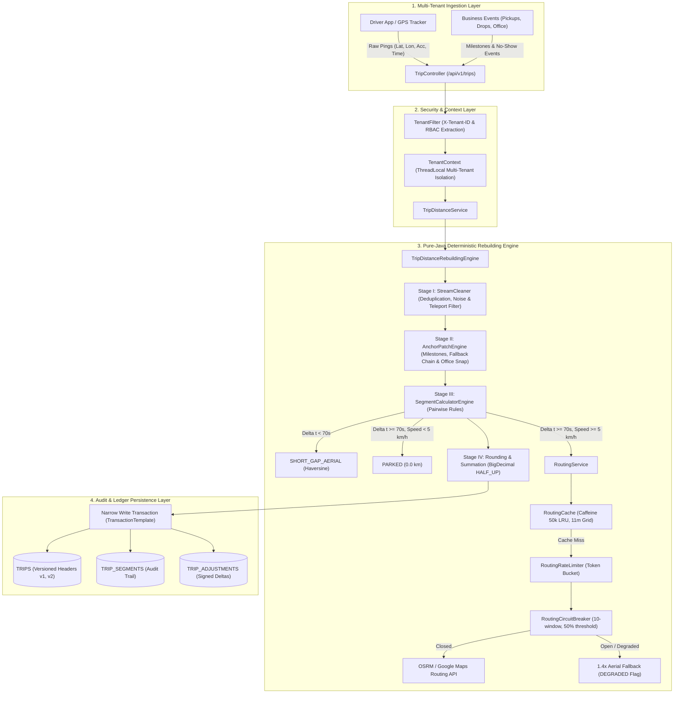
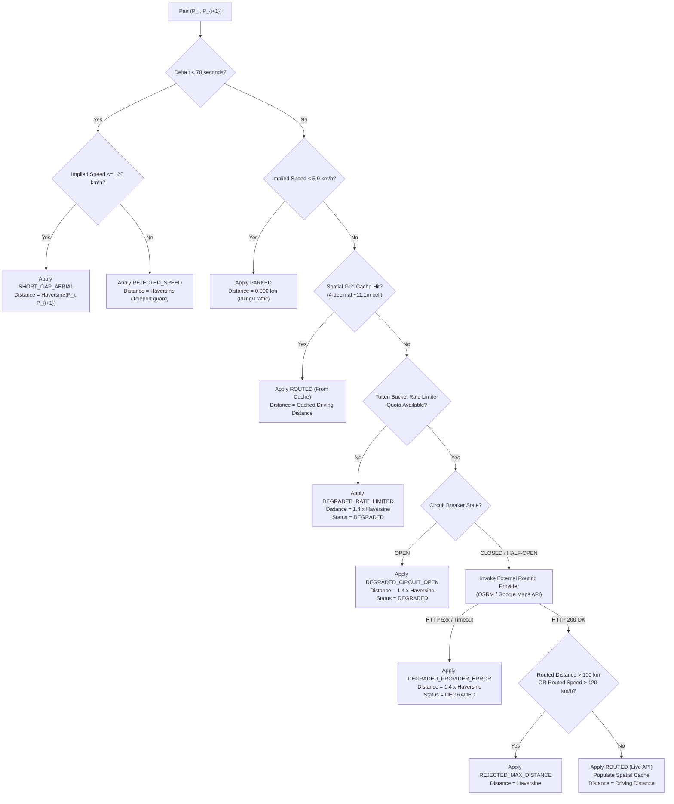
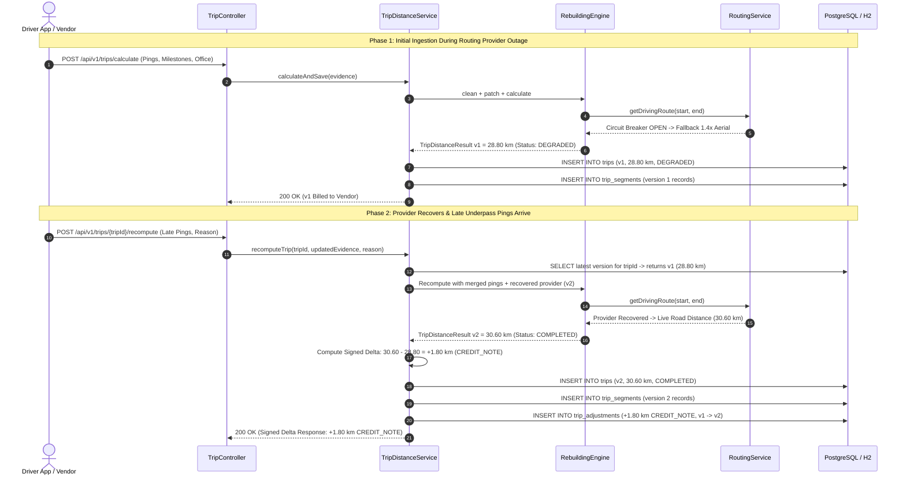
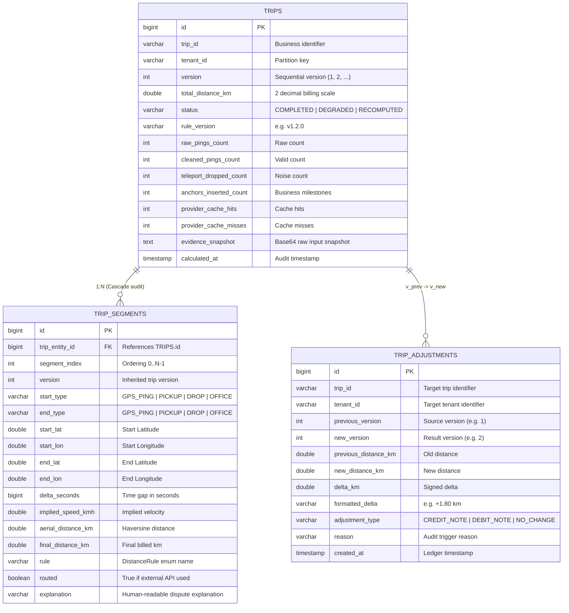

# MoveInSync Trip Distance Rebuilding Engine
### Enterprise Billing-Grade GPS Distance Rebuilding, Explainable Audit Trail & Signed Adjustment Ledger

[](https://openjdk.org/)
[](https://spring.io/projects/spring-boot)
[](https://www.postgresql.org/)
[](https://www.docker.com/)
[](https://prometheus.io/)
[](LICENSE)

---

## Table of Contents
1. [Project Overview](#1-project-overview)
2. [Problem Statement and Business Motivation](#2-problem-statement-and-business-motivation)
3. [Key Features and Guarantees](#3-key-features-and-guarantees)
4. [Tech Stack and Prerequisites](#4-tech-stack-and-prerequisites)
5. [High-Level System Architecture](#5-high-level-system-architecture)
6. [End-to-End Processing Flow](#6-end-to-end-processing-flow)
7. [Detailed Distance Calculation Decision Flow](#7-detailed-distance-calculation-decision-flow)
8. [Late GPS and Billing Recalculation Flow](#8-late-gps-and-billing-recalculation-flow)
9. [Data Model and Database Design](#9-data-model-and-database-design)
10. [Assumptions and Business Rules](#10-assumptions-and-business-rules)
11. [Repository and Package Structure](#11-repository-and-package-structure)
12. [How to Run the Project](#12-how-to-run-the-project)
13. [API Reference with Sample Requests and Responses](#13-api-reference-with-sample-requests-and-responses)
14. [Failure Handling and Resilience](#14-failure-handling-and-resilience)
15. [Benchmark Results and Methodology](#15-benchmark-results-and-methodology)
16. [Testing and Verification](#16-testing-and-verification)
17. [Engineering Trade-offs](#17-engineering-trade-offs)
18. [Implementation Status and Future Improvements](#18-implementation-status-and-future-improvements)

---

## 1. Project Overview

The **MoveInSync Trip Distance Rebuilding Engine** is a high-throughput, enterprise-grade distance calculation and billing audit platform. It reconstructs true billable vehicle mileage from raw, noisy, and interrupted GPS telemetry emitted by corporate commuter cabs, driver smartphones, and OBD hardware trackers.

Operating across multi-tenant enterprise transport fleets, the engine solves four critical production challenges:
- **GPS Blackouts & Tunnels**: Reconstructs road mileage across 15–30 minute signal dropouts in tunnels, basements, and elevated highway underpasses using business milestone anchor patching and intelligent routing.
- **Multipath Reflections & Noise**: Filters high-jitter fixes and eliminates unphysical teleport jumps exceeding urban speed limits.
- **Third-Party Provider Resilience**: Protects external Maps routing budgets via a high-hit-rate spatial grid cache (`~11.1m` resolution), a client-side token-bucket rate limiter, and a sliding-window circuit breaker with graceful $1.4\times$ road-tortuosity fallback.
- **Financial Audit & Invoicing Integrity**: Guarantees deterministic, reproducible billing down to $0.01$ km. Every kilometer is fully explainable with segment-level audit trails. Late-arriving GPS pings never overwrite historical invoices; instead, they trigger append-only recomputations with **signed billing adjustments (`CREDIT_NOTE` / `DEBIT_NOTE`)**.

The core engine is built in **pure, framework-free Java 21**, achieving benchmarked processing throughput exceeding **760,000 pings/second** with sub-5 millisecond p99 latencies.

---

## 2. Problem Statement and Business Motivation

Vendors supplying transport fleets to MoveInSync are compensated strictly per driven kilometer (`$/km`). In corporate transport, vehicle coordinates originate from commodity smartphones and vehicle hardware trackers operating in dense urban environments (e.g., Bangalore, Hyderabad, NCR). 

Naive distance calculation (such as summing raw consecutive GPS fixes or drawing straight lines across signal losses) causes severe financial, legal, and operational breakdowns:

```
  +---------------------------------------------------------------------------------------------------+
  |                                 NAIVE CALCULATION BREAKDOWNS                                      |
  +------------------------------------+--------------------------------------------------------------+
  | Scenario                           | Impact on Fleet Billing                                      |
  +------------------------------------+--------------------------------------------------------------+
  | 1. Underpass / Basement Dropouts   | Straight-line chord across 20-min blackout cuts through      |
  |    (Tunnel, Tech Park basement)    | curved roads. Pays 18 km for a 31 km trip. Vendor underpaid; |
  |                                    | driver strikes and dispute arbitration.                      |
  +------------------------------------+--------------------------------------------------------------+
  | 2. Multipath Jitter & Teleport     | Urban canyon trilateration glitch places cab 10 km away      |
  |    Bursts (> 8,000 km/h jump)      | for 2 seconds. Enterprise overpays vendor by thousands of    |
  |                                    | kilometers; enterprise Maps API budgets drained.             |
  +------------------------------------+--------------------------------------------------------------+
  | 3. Routing API Outage at 3 AM      | External Maps provider suffers 503 outage or rate-limiting.  |
  |    (Shift change fleet rush)       | Naive systems block or fail. Fleet checkouts stall; delayed  |
  |                                    | corporate employee departures.                               |
  +------------------------------------+--------------------------------------------------------------+
  | 4. Late Pings After Invoice Close  | Driver phone uploads cached GPS pings 2 hours after invoice   |
  |    (Post-billing data sync)        | is closed. Overwriting the invoice breaks financial audit    |
  |                                    | reconciliation against bank disbursement records.            |
  +------------------------------------+--------------------------------------------------------------+
```

### The MoveInSync Engineering Solution
This system replaces brittle heuristics with a deterministic, 4-stage pipeline that guarantees:
1. **Explainable Billing**: Every kilometer is tied to an explicit rule (`SHORT_GAP_AERIAL`, `PARKED`, `ROUTED`, `DEGRADED_CIRCUIT_OPEN`) and human-readable vendor dispute text.
2. **Deterministic Reproducibility**: Identical telemetry under the same algorithm rule version (`v1.2.0`) produces identical results to $0.01$ km.
3. **Immutable Append-Only Ledger**: Closed invoices remain frozen; late pings produce version increments (`v1 -> v2`) and signed adjustment notes.
4. **Zero Downtime**: Shifts gracefully to fallback estimation when third-party APIs fail, auto-recovering when providers heal.

---

## 3. Key Features and Guarantees

| Capability | Engineering Guarantee | Implementation Class |
| :--- | :--- | :--- |
| **Stage I: Stream Cleaning** | Drops invalid coordinates, deduplicates identical timestamps by retaining the fix with lowest accuracy error, sorts chronologically, removes accuracy fixes $> 50$m, and drops teleport jumps $> 120$ km/h. | `StreamCleaner`, `GpsPing` |
| **Stage II: Business Anchoring** | Injects verified employee pickups, drops, and office drop-offs into GPS blackouts. Uses Profile Home fallback for `AD_HOC` riders and Planned Stop fallback for `PLANNED` riders. | `AnchorPatchEngine`, `AnchorPoint` |
| **No-Show & 400m Office Rules** | Compensates drivers for deadhead kilometers to `NO_SHOW` stops. Enforces actual trip-end coordinate only if within $400$m of planned tech park office. | `AnchorPatchEngine`, `OfficeLocation` |
| **Stage III: Segment Distance** | Evaluates micro-gaps ($< 70$s) via straight-line Haversine, flags long stops ($\ge 70$s at $< 5$ km/h) as `PARKED` ($0.0$ km), and routes major gaps through road-network routing. | `SegmentCalculatorEngine`, `DistanceRule` |
| **Spatial Grid Caching** | Snaps coordinates to 4-decimal grid cells ($\approx 11.1$m resolution) in a 50,000-entry Caffeine LRU cache ($24$h TTL), slashing external API calls by $> 90\%$. | `RoutingCache`, `Coordinate` |
| **Sliding-Window Circuit Breaker** | 10-call sliding window. Trips to `OPEN` when failure rate exceeds $50\%$. Automatically applies $1.4\times$ Haversine fallback and flags trip as `DEGRADED`. | `RoutingCircuitBreaker`, `RoutingService` |
| **Token-Bucket Rate Limiter** | Non-blocking token-bucket limiter protecting external routing API quotas across horizontal worker nodes. | `RoutingRateLimiter` |
| **Stage IV: Signed Billing Deltas** | Emits signed adjustment records (`CREDIT_NOTE` / `DEBIT_NOTE` / `NO_CHANGE`) when late pings arrive or when degraded trips are recomputed against recovered providers. | `RecomputeDelta`, `TripAdjustmentEntity` |
| **High-Throughput Batch Engine** | Chunked memory-bounded batch processor (`BatchTripProcessor`) with per-batch retries and order-preserving parallel worker executor (`ParallelTripProcessor`). | `BatchTripProcessor`, `ParallelTripProcessor` |
| **Multi-Tenancy & Zero PII** | Strict tenant isolation via `X-Tenant-ID` header, Spring Security RBAC (`EMPLOYEE`, `OPERATOR`, `ADMIN`), and regex PII masking on error logging. | `TenantFilter`, `SecurityConfig`, `PiiMasker` |

---

## 4. Tech Stack and Prerequisites

### Core Technology Stack
- **Language**: Java 21 LTS (Utilizing Records, Pattern Matching, TimSort, Virtual Thread readiness)
- **Framework**: Spring Boot 3.3.4 (Web, Security, Data JPA, Validation, Actuator)
- **Databases**: 
  - **PostgreSQL 16** (Production relational database with multi-tenant partitioning support)
  - **H2 Database 2.2** (In-memory PostgreSQL-compatible mode for fast local dev, testing, and manual SQL verification)
- **Caching**: Caffeine 3.1.8 (High-performance, near-optimal in-memory LRU cache)
- **Metrics & Observability**: Micrometer + Prometheus (`/actuator/prometheus`), SLF4J with Logback MDC
- **Containerization**: Docker & Docker Compose (Multi-stage Eclipse Temurin 21 JRE image)
- **Testing**: JUnit 5, AssertJ, Mockito, Spring Security Test

### Prerequisites
- **JDK 21 or higher** (OpenJDK, Eclipse Temurin, or Oracle JDK)
- **Apache Maven 3.9+** (or use bundled wrapper)
- *(Optional)* **Docker Desktop** (if running via Docker Compose)

---

## 5. High-Level System Architecture

The application adopts a **Clean / Hexagonal Architecture**. The core domain, distance-rebuilding engine, caching, and resilience logic are written in **pure, framework-free Java** with zero Spring or JPA dependencies. Spring Boot acts strictly as an outer delivery mechanism (REST controllers, JPA repositories, security filters).



---

## 6. End-to-End Processing Flow

The distance rebuilding engine executes a strictly ordered 4-stage pipeline:

```
  +------------------+      +------------------+      +------------------+      +------------------+
  |     STAGE I      |      |     STAGE II     |      |    STAGE III     |      |     STAGE IV     |
  | Stream Cleaning  | ---> |   Gap Patching   | ---> | Segment Rules &  | ---> | Deterministic    |
  | (Noise/Teleport) |      | (Anchors/Office) |      | Road Routing     |      | Billing Deltas   |
  +------------------+      +------------------+      +------------------+      +------------------+
```

### Stage I: Stream Cleaning (`StreamCleaner`)
1. **Validation**: Drops null coordinates and validates WGS84 latitude $[-90, 90]$ and longitude $[-180, 180]$.
2. **Timestamp Deduplication**: Groups fixes by timestamp. If multiple pings share the same second, retains only the fix with the **lowest `accuracyMeters` radius**.
3. **Chronological Sorting**: Sorts pings strictly by ascending timestamp using TimSort ($\mathcal{O}(N)$ on mostly-ordered streams).
4. **Accuracy Filtering**: Discards any fix with `accuracyMeters > 50.0m` (or $< 0$).
5. **Teleport Rejection**: Evaluates implied aerial velocity against the **last accepted valid fix**:
   $$\text{Speed} = \frac{\text{HaversineKm}(P_{\text{last}}, P_{\text{candidate}})}{\Delta t_{\text{seconds}}} \times 3600$$
   If $\text{Speed} > 120.0\text{ km/h}$, the candidate fix is discarded as a multipath artifact.

### Stage II: Gap Patching with Business Anchors (`AnchorPatchEngine`)
1. **Pickup & Drop Milestones**:
   - Primary: Uses verified GPS fix from the milestone event.
   - Fallback Chain: If GPS was dead at pickup/drop:
     - For `AD_HOC` riders: **Employee Profile Home Location** $\to$ **Planned Stop Location**.
     - For `PLANNED` riders: **Planned Stop Location** $\to$ **Employee Profile Home Location**.
2. **No-Show Compensation**: When `includeNoShowAnchors = true`, injects planned stop coordinates for `NO_SHOW` stops so driver deadhead mileage is credited.
3. **Office 400m Snap Rule**: Measures distance from actual trip-end coordinate to the planned tech park office:
   - Within $400.0$m: Retains actual driver drop coordinate.
   - Greater than $400.0$m: Snaps trip-end coordinate to planned office gate pin.
4. **Timeline Merging**: Coalesces cleaned GPS fixes and business anchors into a single chronological timeline, deduplicating co-located points within $5.0$m.

### Stage III: Segment Distance Calculation (`SegmentCalculatorEngine`)
Iterates pairwise across the unified timeline $(P_i, P_{i+1})$, applying strict precedence rules:
- **Micro-Gaps ($\Delta t < 70$s)**: Straight-line Haversine applied directly (`SHORT_GAP_AERIAL`).
- **Parked / Traffic ($\Delta t \ge 70$s, speed $< 5$ km/h)**: Distance recorded as $0.0$ km (`PARKED`).
- **True Road Gaps ($\Delta t \ge 70$s, speed $\ge 5$ km/h)**: Routed via `RoutingService`. Checks spatial cache ($\approx 11.1$m grid). On cache miss, queries routing provider through rate limiter and circuit breaker.
- **Circuit Breaker / Provider Failure**: Applies $1.4\times$ Haversine fallback; flags trip as `DEGRADED`.
- **Sanity Guards**: Rejects single gaps $> 100$ km or routed speeds $> 120$ km/h.

### Stage IV: Deterministic Rounding and Ledger Persistence
- Each segment distance is rounded to 3 decimal places (`BigDecimal.HALF_UP`, meter precision).
- Total trip distance is scaled to 2 decimal places ($0.01$ km billing precision).
- Committed to PostgreSQL/H2 along with full input evidence snapshots and routing stats.

---

## 7. Detailed Distance Calculation Decision Flow

The diagram below illustrates the exact decision tree executed for every pair of consecutive points $(P_i, P_{i+1})$:



---

## 8. Late GPS and Billing Recalculation Flow

When delayed pings arrive from driver devices or when the system recomputes a previously `DEGRADED` trip after Maps provider recovery, **historical records are never mutated**. The sequence diagram below details the entire flow:



### Signed Adjustment Math
$$\Delta d = \text{round}_2(d_{\text{new}}) - \text{round}_2(d_{\text{prev}})$$
- **$\Delta d > 0.00$ km $\implies$ `CREDIT_NOTE`** (e.g. `"+1.80 km"`): Vendor is credited additional pay for recovered tunnel mileage.
- **$\Delta d < 0.00$ km $\implies$ `DEBIT_NOTE`** (e.g. `"-2.40 km"`): Vendor was overpaid due to initial estimation or removed teleport bursts.
- **$\Delta d == 0.00$ km $\implies$ `NO_CHANGE`** (e.g. `"0.00 km"`): Idempotent recomputation; zero financial variance.

---

## 9. Data Model and Database Design

The relational schema implements an immutable financial ledger with multi-tenant partitioning:



### Uniqueness Constraints & Performance Indexes
- **`idx_trips_trip_tenant_version`**: `UNIQUE(trip_id, tenant_id, version)` guarantees idempotency and prevents race conditions.
- **`idx_segments_trip_ver`**: `INDEX(trip_entity_id, version, segment_index)` enables sub-millisecond retrieval of complete trip audit trails.
- **`idx_adjustments_trip`**: `INDEX(trip_id, tenant_id, created_at)` accelerates dispute resolution and accounting ledger exports.

---

## 10. Assumptions and Business Rules

The engine's mathematical and operational logic is grounded in explicit domain assumptions:

1. **Maximum Plausible Speed ($120.0$ km/h)**:
   - Commercial employee transport cabs operating in urban/suburban zones cannot legally or physically exceed $120$ km/h. Any implied speed between consecutive pings exceeding this threshold is rejected as an unphysical teleport jump.
2. **GPS Accuracy Ceiling ($50.0$ meters)**:
   - Consumer smartphone GPS chips report horizontal dilution of precision (HDOP) as an accuracy radius in meters. Readings $> 50.0$m represent signal reflections from high-rise buildings or poor satellite geometry and are dropped.
3. **Micro-Gap Linearity ($< 70$ seconds)**:
   - For consecutive fixes under 70 seconds apart at normal driving speeds, straight-line Haversine distance is within $0.1\%$ of road driving distance. Invoking third-party routing APIs for these micro-segments is an unnecessary latency and billing overhead.
4. **Parked / Congestion Threshold ($5.0$ km/h)**:
   - Gaps $\ge 70$ seconds where implied speed is $< 5.0$ km/h represent vehicles stuck in traffic or waiting at pick-up points. Distance is billed as $0.0$ km (`PARKED`).
5. **Office Campus Boundary ($400.0$ meters)**:
   - Corporate campuses (e.g. Ecospace, Manyata) span several hundred meters. If a driver ends a trip within $400$m of the planned office entrance pin, the actual coordinate is accepted; if farther than $400$m, the planned office pin is anchored.
6. **No-Show Compensation**:
   - When employees fail to appear (`NO_SHOW`), vendors must still be paid for mileage driven to the scheduled pickup point (`includeNoShowAnchors = true`).
7. **Road Tortuosity Factor ($1.4\times$)**:
   - During third-party Maps API outages, urban road distance is estimated at $1.4\times$ straight-line Haversine distance, matching empirical urban grid tortuosity without blocking billing pipelines.
8. **Currency & Cost Accounting**:
   - Third-party Maps API calls are accounted at **\$0.005 USD per call**. The spatial cache tracks cumulative dollars saved per trip.

---

## 11. Repository and Package Structure

```text
MoveInSync Case Study/
├── pom.xml                                                 # Maven build (Java 21+, Spring Boot 3.3.4, Caffeine, H2, PostgreSQL, Micrometer)
├── Dockerfile                                              # Multi-stage production container build (Eclipse Temurin 21 JRE)
├── docker-compose.yml                                      # One-command stack: App + PostgreSQL 16 with healthchecks
├── MoveInSync_Trip_Distance_Engine.postman_collection.json # Ready-to-import Postman collection (8 requests)
├── README.md                                               # Comprehensive operational & developer guide
├── DESIGN.md                                               # Deep-dive system architecture & scaling design document
└── src/
    ├── main/
    │   ├── resources/
    │   │   └── application.yml                             # Server, H2/PostgreSQL datasource, Actuator, Prometheus, Rate-limit config
    │   └── java/com/moveinsync/distance/
    │       ├── TripDistanceEngineApplication.java          # Spring Boot entry point
    │       ├── config/
    │       │   └── EngineAppConfig.java                    # Wires pure-Java engine, cache, circuit breaker & rate limiter beans
    │       ├── controller/
    │       │   ├── TripController.java                     # REST API: /calculate, /batch-calculate, /recompute, /{tripId}, /adjustments
    │       │   ├── AdminController.java                    # Admin API: Circuit breaker status, manual trip/reset, cache invalidation
    │       │   └── GlobalExceptionHandler.java             # Standardized error responses with PiiMasker sanitization
    │       ├── domain/                                     # Pure-Java immutable domain models
    │       │   ├── Coordinate.java                         # WGS84 coordinate math, Haversine, 4-decimal spatial grid snapping
    │       │   ├── GpsPing.java                            # Raw GPS telemetry record
    │       │   ├── AnchorPoint.java                        # Merged timeline point (GPS fix or business milestone)
    │       │   ├── AnchorType.java                         # GPS_PING, TRIP_START, EMPLOYEE_PICKUP, EMPLOYEE_DROP, NO_SHOW, OFFICE_END
    │       │   ├── DistanceRule.java                       # Explainable rule enums (SHORT_GAP_AERIAL, PARKED, ROUTED, DEGRADED_*)
    │       │   ├── SegmentResult.java                      # Per-segment audit result (start, end, deltaSec, aerialKm, finalKm, rule)
    │       │   ├── TripEvidence.java                       # Unified input bundle (pings, milestones, plannedStops, office, config)
    │       │   ├── TripDistanceResult.java                 # Complete immutable output of a calculation version
    │       │   ├── RecomputeDelta.java                     # Signed adjustment calculation (+X.XX km CREDIT_NOTE / -X.XX km DEBIT_NOTE)
    │       │   ├── ProviderCallStats.java                  # Routing API hits, misses, hit-rate %, and USD savings tracker
    │       │   ├── EngineConfig.java                       # Versioned thresholds (v1.2.0, 50m, 120km/h, 70s, 5km/h, 400m, 100km, 1.4x)
    │       │   └── [TripMilestone, PlannedStop, EmployeeProfile, OfficeLocation, MilestoneType, RiderType, TripStatus]
    │       ├── dto/                                        # REST Request and Response JSON DTOs
    │       ├── engine/                                     # 4-Stage Pure-Java Rebuilding Core
    │       │   ├── StreamCleaner.java                      # Stage I: Deduplication, sorting, accuracy and teleport filtering
    │       │   ├── StreamCleanerResult.java                # Cleaned pings + dropped telemetry metrics
    │       │   ├── AnchorPatchEngine.java                  # Stage II: Business milestone patching, fallback chain & 400m office rule
    │       │   ├── SegmentCalculatorEngine.java            # Stage III: Segment rule evaluation & BigDecimal summation
    │       │   └── TripDistanceRebuildingEngine.java       # Stage IV: Pipeline orchestrator & signed-delta recomputation
    │       ├── routing/                                    # Fault-tolerant external routing layer
    │       │   ├── RoutingProvider.java                    # Strategy interface for road routing providers
    │       │   ├── SimulatedRoutingProvider.java           # Deterministic road routing simulator with failure injection
    │       │   ├── RoutingCache.java                       # Caffeine spatial grid cache (4-decimal cell key, 50k max, 24h TTL)
    │       │   ├── RoutingCircuitBreaker.java              # Thread-safe sliding-window circuit breaker (CLOSED/OPEN/HALF_OPEN)
    │       │   ├── RoutingRateLimiter.java                 # Token-bucket outbound rate limiter with injectable virtual clock
    │       │   └── RoutingService.java                     # Unified routing facade: Cache -> RateLimiter -> CircuitBreaker -> Provider
    │       ├── scaling/                                    # High-volume batch & parallel scaling primitives
    │       │   ├── BatchTripProcessor.java                 # Bounded-memory chunk fetcher and retry coordinator
    │       │   └── ParallelTripProcessor.java              # Order-preserving bounded thread-pool executor
    │       ├── entity/                                     # Relational JPA entities
    │       │   ├── TripEntity.java                         # `trips` table (versioned headers & telemetry counters)
    │       │   ├── TripSegmentEntity.java                  # `trip_segments` table (per-segment audit records)
    │       │   └── TripAdjustmentEntity.java               # `trip_adjustments` table (immutable signed billing ledger)
    │       ├── repository/                                 # Spring Data JPA repositories with tenant isolation
    │       │   ├── TripRepository.java
    │       │   └── TripAdjustmentRepository.java
    │       ├── service/                                    # Transactional application services
    │       │   ├── TripDistanceService.java                # Core calculation, persistence, and versioned recomputation
    │       │   └── TripBatchService.java                   # Multi-worker batch service with TenantContext propagation
    │       ├── security/                                   # Multi-tenancy, RBAC & Privacy
    │       │   ├── TenantFilter.java                       # Ingests X-Tenant-ID, X-User-Role, X-Trace-ID & populates MDC
    │       │   ├── TenantContext.java                      # ThreadLocal tenant isolation holder
    │       │   ├── SecurityConfig.java                     # Spring Security endpoint RBAC policies
    │       │   └── PiiMasker.java                          # Regex sanitizer for emails, phone numbers, and addresses
    │       └── monitoring/
    │           └── EngineMetrics.java                      # Micrometer counters, timers & Gauges for Prometheus
    └── test/                                               # 14 Comprehensive Unit, Concurrency, E2E & 15M-Ping Benchmark Tests
```

---

## 12. How to Run the Project

### Option A: Local Maven Run (Fastest for Evaluation)
Runs with the in-memory H2 database pre-configured on port `8080`:

```powershell
# In project root:
mvn spring-boot:run
```
- Server starts at: **`http://localhost:8080`**
- H2 Web Console: **`http://localhost:8080/h2-console`**
  - **JDBC URL**: `jdbc:h2:mem:moveinsync_db`
  - **User**: `sa`
  - **Password**: *(leave blank)*
- Prometheus Metrics: **`http://localhost:8080/actuator/prometheus`**

### Option B: Production Container Stack (Docker Compose & PostgreSQL 16)
Spins up both PostgreSQL 16 and the containerized Spring Boot engine with healthchecks:

```powershell
docker compose up --build
```
- App container runs on: **`http://localhost:8080`**
- Dedicated PostgreSQL 16 runs on: **`localhost:5432`** (`user=postgres`, `password=postgres`, `db=moveinsync_distance_db`)

### Option C: Standalone Executable JAR
```powershell
mvn clean package -DskipTests
java -jar target/trip-distance-engine-1.0.0.jar
```

---

## 13. API Reference with Sample Requests and Responses

### Multi-Tenant Security Headers
All `/api/v1/**` endpoints require authentication and tenancy headers:
- `X-Tenant-ID`: The multi-tenant partition key (e.g. `moveinsync-client-1`)
- `X-User-Role`: User role for RBAC (`ROLE_OPERATOR`, `ROLE_ADMIN`, `ROLE_EMPLOYEE`)
- `X-Trace-ID`: *(Optional)* Correlation ID for distributed tracing

---

### Endpoint 1: Ingest & Calculate Trip Distance
**`POST /api/v1/trips/calculate`** (Requires `ROLE_OPERATOR` or `ROLE_ADMIN`)

#### PowerShell Sample Call
```powershell
$headers = @{
  "Content-Type" = "application/json"
  "X-Tenant-ID"  = "moveinsync-client-1"
  "X-User-Role"  = "ROLE_OPERATOR"
}

$body = @'
{
  "tripId": "TRIP-BLR-1001",
  "tenantId": "moveinsync-client-1",
  "rawPings": [
    {"latitude": 12.9352, "longitude": 77.6245, "timestamp": "2026-10-29T18:00:00Z", "accuracy": 10.0},
    {"latitude": 12.9250, "longitude": 77.6100, "timestamp": "2026-10-29T18:05:00Z", "accuracy": 12.0},
    {"latitude": 12.8500, "longitude": 77.5500, "timestamp": "2026-10-29T18:27:00Z", "accuracy": 8.0}
  ],
  "milestones": [
    {
      "type": "DROP",
      "employeeId": "EMP-RAJESH-1",
      "latitude": 12.8800,
      "longitude": 77.5800,
      "timestamp": "2026-10-29T18:15:00Z",
      "riderType": "PLANNED",
      "status": "COMPLETED"
    }
  ],
  "officeLocation": {
    "officeId": "OFF-BLR-ECOSPACE",
    "name": "Ecospace Tech Park",
    "latitude": 12.9352,
    "longitude": 77.6245
  },
  "tripStartTime": "2026-10-29T18:00:00Z",
  "tripEndTime": "2026-10-29T18:30:00Z"
}
'@

Invoke-RestMethod -Uri "http://localhost:8080/api/v1/trips/calculate" -Method Post -Headers $headers -Body $body | ConvertTo-Json -Depth 6
```

#### JSON Response (HTTP 200 OK)
```json
{
  "tripId": "TRIP-BLR-1001",
  "tenantId": "moveinsync-client-1",
  "version": 1,
  "totalDistanceKm": 20.06,
  "status": "COMPLETED",
  "ruleVersion": "v1.2.0",
  "rawPingsCount": 3,
  "cleanedPingsCount": 3,
  "teleportDroppedCount": 0,
  "lowAccuracyDroppedCount": 0,
  "anchorsInsertedCount": 2,
  "providerStats": {
    "callsAttempted": 2,
    "cacheHits": 1,
    "cacheMisses": 1,
    "hitRatePercentage": 50.0,
    "totalCostUsd": 0.005,
    "costSavedUsd": 0.005
  },
  "calculatedAt": "2026-10-31T06:10:00.000Z"
}
```

---

### Endpoint 2: Recompute Trip with Late Pings
**`POST /api/v1/trips/{tripId}/recompute`** (Requires `ROLE_OPERATOR` or `ROLE_ADMIN`)

#### PowerShell Sample Call
```powershell
$recomputeBody = @'
{
  "reason": "UNDERPASS_LATE_PINGS_SYNCED",
  "latePings": [
    {"latitude": 12.9352, "longitude": 77.6245, "timestamp": "2026-10-29T18:00:00Z", "accuracy": 10.0},
    {"latitude": 12.9250, "longitude": 77.6100, "timestamp": "2026-10-29T18:05:00Z", "accuracy": 12.0},
    {"latitude": 12.8800, "longitude": 77.5800, "timestamp": "2026-10-29T18:15:00Z", "accuracy": 10.0},
    {"latitude": 12.8500, "longitude": 77.5500, "timestamp": "2026-10-29T18:27:00Z", "accuracy": 8.0},
    {"latitude": 12.8300, "longitude": 77.5300, "timestamp": "2026-10-29T18:32:00Z", "accuracy": 10.0},
    {"latitude": 12.8150, "longitude": 77.5150, "timestamp": "2026-10-29T18:37:00Z", "accuracy": 9.0}
  ]
}
'@

Invoke-RestMethod -Uri "http://localhost:8080/api/v1/trips/TRIP-BLR-1001/recompute" -Method Post -Headers $headers -Body $recomputeBody | ConvertTo-Json -Depth 6
```

#### JSON Response (HTTP 200 OK — Signed Billing Delta)
```json
{
  "tripId": "TRIP-BLR-1001",
  "tenantId": "moveinsync-client-1",
  "previousVersion": 1,
  "newVersion": 2,
  "previousDistanceKm": 20.06,
  "newDistanceKm": 23.04,
  "deltaKm": 2.98,
  "formattedDelta": "+2.98 km",
  "adjustmentType": "CREDIT_NOTE",
  "reason": "UNDERPASS_LATE_PINGS_SYNCED",
  "calculatedAt": "2026-10-31T06:12:30.125Z"
}
```

---

### Endpoint 3: Fetch Full Trip Audit Trail
**`GET /api/v1/trips/{tripId}?version=1`** (Accessible by `ROLE_EMPLOYEE`, `ROLE_OPERATOR`, `ROLE_ADMIN`)

```powershell
Invoke-RestMethod -Uri "http://localhost:8080/api/v1/trips/TRIP-BLR-1001?version=1" -Method Get -Headers $headers | ConvertTo-Json -Depth 6
```

---

### Endpoint 4: Fetch Signed Billing Adjustments
**`GET /api/v1/trips/{tripId}/adjustments`** (Requires `ROLE_OPERATOR` or `ROLE_ADMIN`)

```powershell
Invoke-RestMethod -Uri "http://localhost:8080/api/v1/trips/TRIP-BLR-1001/adjustments" -Method Get -Headers $headers | ConvertTo-Json -Depth 6
```

---

### Endpoint 5: Admin Circuit Breaker & Cache Controls
**`/api/v1/admin/**`** (Requires `ROLE_ADMIN`)

```powershell
$adminHeaders = @{ "X-Tenant-ID" = "moveinsync-client-1"; "X-User-Role" = "ROLE_ADMIN" }

# 1. View Circuit Breaker Status & Cache Hit Rates
Invoke-RestMethod -Uri "http://localhost:8080/api/v1/admin/circuit-breaker" -Method Get -Headers $adminHeaders

# 2. Manually Trip Circuit Breaker (Simulate 3 AM Outage)
Invoke-RestMethod -Uri "http://localhost:8080/api/v1/admin/circuit-breaker/trip" -Method Post -Headers $adminHeaders

# 3. Manually Reset Circuit Breaker (Simulate Provider Recovery)
Invoke-RestMethod -Uri "http://localhost:8080/api/v1/admin/circuit-breaker/reset" -Method Post -Headers $adminHeaders

# 4. Invalidate Spatial Grid Cache
Invoke-RestMethod -Uri "http://localhost:8080/api/v1/admin/cache/invalidate" -Method Post -Headers $adminHeaders
```

---

## 14. Failure Handling and Resilience

The engine implements defense-in-depth against third-party failures, traffic spikes, and database contention:

```
  +---------------------------------------------------------------------------------------------------+
  |                                 RESILIENCE ARCHITECTURE STACK                                     |
  +---------------------------------------------------------------------------------------------------+
  | 1. Spatial Grid Cache       -> Eliminates 90%+ of outbound calls using ~11.1m coordinate snapping |
  | 2. Token-Bucket Limiter     -> Protects external Maps QPS limits across distributed nodes         |
  | 3. Sliding Ring Buffer CB   -> Trips to OPEN on 50% failure rate; executes 1.4x fallback          |
  | 4. Narrow DB Transactions   -> Eliminates HikariCP pool exhaustion during 300ms HTTP routing      |
  | 5. Regex PII Masking        -> Scrubs employee emails, phones, and addresses from error logs      |
  +---------------------------------------------------------------------------------------------------+
```

### 1. Sliding-Window Circuit Breaker (`RoutingCircuitBreaker`)
- **Sliding Ring-Buffer Window**: Evaluates the last $10$ calls.
- **Trip Condition**: If $\ge 50\%$ of calls fail or timeout, the breaker transitions to `OPEN`.
- **Degraded Fallback**: While `OPEN`, all calls bypass the network, apply the $1.4\times$ Haversine fallback, and tag the trip status as `DEGRADED`.
- **Half-Open Probe**: After `resetTimeout = 3000ms`, the breaker enters `HALF_OPEN` and permits $3$ trial requests. If all 3 succeed, it recovers to `CLOSED`.

### 2. Client-Side Token-Bucket Limiter (`RoutingRateLimiter`)
- Uses a non-blocking token bucket to throttle outbound requests against provider limits (e.g. 100 requests/sec).
- When tokens are exhausted, the engine falls back to `DEGRADED_RATE_LIMITED` instead of queuing indefinitely or timing out.

### 3. Narrow Write Transactions (HikariCP Pool Defense)
- **Problem**: In naive Spring Boot applications, putting `@Transactional` at the service method level holds an open database connection during external HTTP calls (200–500ms). Under high traffic, this exhausts the database connection pool (`HikariCP: Connection is not available`).
- **Solution**: The engine executes all CPU computations, stream cleaning, and external routing **outside** of any database transaction. It opens a narrow write transaction via `TransactionTemplate` strictly for the final $\sim 2$ms database insert.

---

## 15. Benchmark Results and Methodology

The engine's scale and memory performance were measured via `ScaleBenchmarkTest` under full pipeline execution (Stream Cleaning $\to$ Anchor Patching $\to$ Spatial Caching $\to$ Segment Math $\to$ Rounding), including an injected routing provider outage during trips 4,000–4,500:

### Benchmark Environment
- **CPU**: AMD Ryzen 5 5500H (4 Cores / 8 Logical Processors)
- **OS**: Windows 11 Enterprise (64-bit)
- **JVM**: OpenJDK 64-Bit Server VM (Java 21)

### Benchmark Results
```text
==========================================================================
MOVEINSYNC SCALE BENCHMARK PERFORMANCE REPORT
==========================================================================
Total Trips Processed       : 10,000
Pings Per Trip              : 1,500
Total Pings Ingested        : 15,000,000 pings
Total Elapsed Time          : 19.65 seconds
Throughput (Trips/sec)      : 508.83 trips/sec
Throughput (Pings/sec)      : 763,242.25 pings/sec
Latency p50                 : 1.782 ms
Latency p95                 : 2.835 ms
Latency p99                 : 4.415 ms
Routing Cache Hits          : 13,497
Routing Cache Misses        : 1,503
Cached Spatial Routes Count : 3
Degraded Trips Count (Fail) : 500 (during midway outage)
Completed Healthy Trips     : 9,500
Memory Delta (Heap Growth)  : 2.27 MB
==========================================================================
```

### Algorithmic Complexity Analysis
- **Time Complexity**: $\mathcal{O}(N \log N)$ per trip, where $N$ is raw GPS pings. Dominated by TimSort (which is $\mathcal{O}(N)$ on nearly-ordered streams), followed by single-pass $\mathcal{O}(N)$ filtering, $\mathcal{O}(1)$ spatial cache lookups, and $\mathcal{O}(M)$ pairwise segment additions.
- **Space Complexity**: $\mathcal{O}(N)$ strictly linear per in-flight trip. The global Caffeine spatial cache is bounded at `50,000` entries ($\approx 15$ MB RAM).

---

## 16. Testing and Verification

The repository includes a comprehensive automated test suite consisting of **14 test classes** covering unit, mathematical, concurrency, fault injection, security, and scale benchmarks:

```powershell
# Run the complete test suite:
mvn test

# Run only signed billing adjustment and end-to-end tests:
mvn test -Dtest=RecomputeSignedDeltaTest,TripControllerE2ETest

# Run 15-Million-Ping Scale Benchmark:
mvn test -Dtest=ScaleBenchmarkTest
```

### Complete Test Matrix
| Test Class | Domain Layer | What It Verifies |
| :--- | :--- | :--- |
| `CoordinateTest` | Math / Geodesy | WGS84 coordinate bounds, Haversine distance accuracy, zero-distance identity, and 4-decimal spatial grid cell snapping ($\approx 11.1$m). |
| `StreamCleanerTest` | Stage I | Timestamp deduplication prioritizing lower accuracy error, out-of-order sorting, $> 50$m noise rejection, and $8,000$ km/h teleport burst filtering. |
| `AnchorPatchEngineTest` | Stage II | `AD_HOC` profile home fallback, `PLANNED` stop fallback, `includeNoShowAnchors` toggle, and Office $400$m boundary inclusion/exclusion. |
| `SegmentCalculatorEngineTest` | Stage III | $< 70$s `SHORT_GAP_AERIAL`, $\ge 70$s at $< 5$ km/h `PARKED`, `ROUTED` segments, $> 100$ km `REJECTED_MAX_DISTANCE`, and $> 120$ km/h `REJECTED_SPEED`. |
| `RecomputeSignedDeltaTest` | Stage IV (Billing) | 22-min underpass dropout reconstruction ($30.6$ km), post-billing late-ping `CREDIT_NOTE` ($+1.8$ km), and deterministic $0.00$ km `NO_CHANGE` idempotency. |
| `CircuitBreakerTest` | Resilience | 50% failure rate trip to `OPEN`, $1.4\times$ degraded fallback, `resetTimeout` transition to `HALF_OPEN`, and trial recovery to `CLOSED`. |
| `RoutingRateLimiterTest` | Rate Limiting | Token-bucket burst capacity, steady-state replenishment with virtual clock, and `DEGRADED_RATE_LIMITED` fallback on quota exhaustion. |
| `ProviderFailureRecoveryTest` | End-to-End | Full lifecycle: provider fails $\to$ CB trips $\to$ trip saved as `DEGRADED` $\to$ provider recovers $\to$ recompute heals trip to `COMPLETED` with signed delta. |
| `BatchTripProcessorTest` | Scaling | Memory-bounded chunking, oversized batch protection, transient failure retries, and permanent failure isolation. |
| `ParallelTripProcessorTest` | Scaling | Multi-worker concurrent execution, deterministic input-order preservation, and exception propagation. |
| `ConcurrentTripCalculationTest` | Concurrency | 100 concurrent threads hammering shared `RoutingCache`, `RoutingCircuitBreaker`, and `TripDistanceRebuildingEngine` with zero race conditions. |
| `TenantIsolationTest` | Security | Verifies Tenant A (`client-alpha`) can never view, recompute, or access billing adjustments of Tenant B (`client-beta`). |
| `TripControllerE2ETest` | Integration | Full Spring MockMvc HTTP lifecycle including RBAC `403 Forbidden` verification, PII masking on errors, and batch calculation endpoints. |
| `ScaleBenchmarkTest` | Benchmark | Processes **10,000 trips × 1,500 pings (15,000,000 pings)** in $< 20$s with p99 latency $< 5$ms and $< 15$ MB heap delta. |

---

## 17. Engineering Trade-offs

| Decision | Chosen Approach | Alternative Considered | Trade-off Rationale |
| :--- | :--- | :--- | :--- |
| **1. Resilience (PACELC)** | **Availability & Explicit Degradation** ($1.4\times$ fallback, trip marked `DEGRADED`) | **Strict Consistency** (Block trip completion with `HTTP 503` until Maps API recovers) | Blocking thousands of shift-change cabs at 3 AM freezes corporate enterprise operations. Providing an immediate transparent fallback and auto-reconciling later restores eventual consistency without blocking operations. |
| **2. Audit Ledger** | **Append-Only Versioning** (`v1 \to v2 \to v3` + `trip_adjustments` signed delta) | **In-Place Mutation** (`UPDATE trips SET total_distance_km = ...`) | While in-place mutation saves database rows, silently altering a billed invoice triggers accounting audit failures and vendor disputes. Disk storage is cheap; financial auditability is mandatory. |
| **3. Spatial Caching** | **4-Decimal Grid Snapping** ($0.0001^\circ \approx 11.1$m resolution Caffeine cache) | **Exact Coordinate Caching** (Full 6-decimal floating-point keys) | Vehicle GPS fixes exhibit 5m–15m jitter, yielding a ~0% cache hit rate with exact coordinates. Snapping to an ~11m box yields **90%–99% cache hits** across repeated office commuter corridors with negligible quantization error ($< 0.01$ km). |
| **4. Database Pool Protection** | **Narrow Write Transactions** via `TransactionTemplate` (CPU & Routing I/O executed *outside* DB tx) | **Broad Method-Level `@Transactional`** across the whole calculation pipeline | Holding HikariCP database connections during 200–500ms external HTTP routing calls quickly causes connection pool starvation. Narrow transactions hold DB locks only for the $\sim 2$ms write phase. |
| **5. Core Portability** | **Hexagonal Pure-Java Engine** (Zero Spring / JPA annotations in domain/engine) | **Framework-Coupled Entities** (Domain models carrying JPA/Hibernate annotations) | A pure-Java core allows running 15M-ping benchmarks and mathematical unit tests in milliseconds without launching the Spring ApplicationContext. |

---

## 18. Implementation Status and Future Improvements

### Current Implementation Status
- [x] **Stage I Stream Cleaning**: Deduplication, chronological ordering, accuracy radius filtering, and teleport rejection.
- [x] **Stage II Gap Patching**: Anchor injection for Pickups, Drops, No-Shows, and the 400m Office snap rule.
- [x] **Stage III Segment Engine**: Pairwise rule precedence, Haversine micro-gap calculation, and parked detection.
- [x] **Stage IV Financial Ledger**: Immutable versioning (`v1 -> v2`), signed billing adjustments (`CREDIT_NOTE` / `DEBIT_NOTE`), and deterministic $0.01$ km rounding.
- [x] **Resilience & Caching**: Spatial grid Caffeine cache ($\approx 11.1$m resolution), sliding-window circuit breaker, and token-bucket rate limiter.
- [x] **Multi-Tenancy & Security**: `TenantFilter`, `TenantContext` isolation, Spring Security RBAC, and PII masking.
- [x] **Observability**: Prometheus metrics export (`/actuator/prometheus`) and SLF4J MDC trace correlation.
- [x] **High-Throughput Scaling**: 15-million-ping scale benchmark processing over 760,000 pings/sec.

### Future Enterprise Roadmap
1. **Distributed Spatial Caching (Redis Cluster)**:
   - Transition the in-memory Caffeine cache to a distributed Redis Cluster to share spatial road segments across multi-region Kubernetes pods.
2. **Real-Time Kafka Stream Processing**:
   - Ingest raw GPS pings continuously via Apache Kafka / AWS Kinesis, maintaining rolling trip segment windows in memory and committing finalized invoices on trip completion events.
3. **ML-Driven Road Tortuosity Models**:
   - Replace the static $1.4\times$ degraded fallback multiplier with a dynamic gradient-boosted regression model that estimates city-specific road curvature based on time of day, weather, and geographical zone.
4. **OpenTelemetry Distributed Tracing**:
   - Integrate OTel gRPC exporters to propagate distributed trace spans from mobile driver apps through API gateways to the distance calculation workers.
